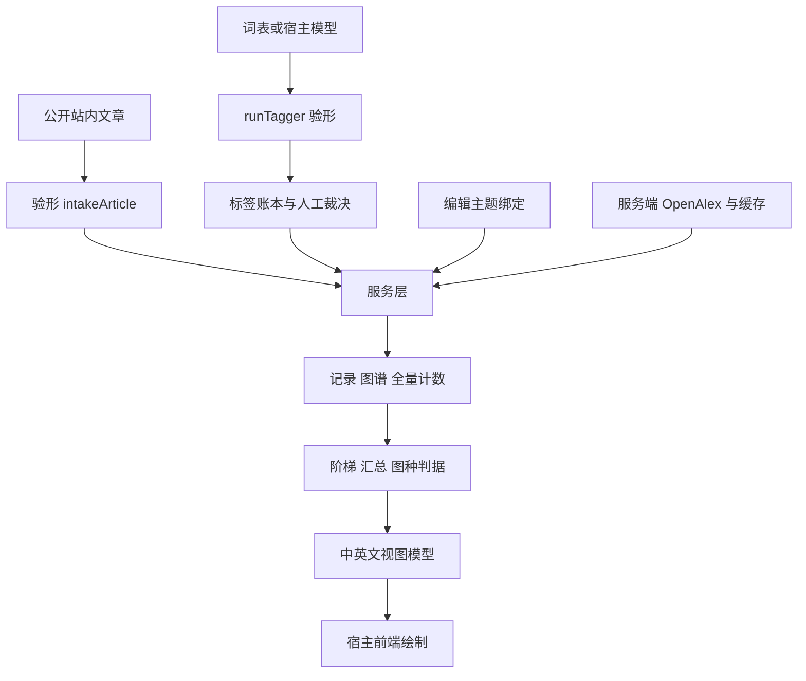

# 架构与数据契约

## 五个包入口

| 入口 | 执行位置 | 内容 |
|---|---|---|
| `scholar-meta` | 服务端、浏览器、移动端 | 类型、纯判据、验形、标签、账本、设置、展示 |
| `scholar-meta/service` | 服务端 | 组合文章源、绑定、账本、评级、缓存与外部源；导出存储端口和内存实现 |
| `scholar-meta/http` | 服务端 | Web 标准 Request → Response |
| `scholar-meta/client` | 浏览器、移动端 | 请求宿主 API、校验返回形状 |
| `scholar-meta/openalex` | 服务端 | 外部请求、主题树、作品、计数、额度 |

根入口不导出服务端适配器。`src/` 没有运行时依赖，不读取环境变量，不依赖宿主框架；有 IO 的能力通过注入端口完成。浏览器入口不依赖 `URL` / `URLSearchParams`，HTTP 服务端则使用 Web 标准 URL。

## 三种数据粒度

| 数据 | 用来回答 | 不应拿来回答 |
|---|---|---|
| `EvidenceRecord` | 单篇研究的信息与可用效应字段 | 自动认定研究可靠、认定因果 |
| `EvidenceMapData` | 标签/主题图谱、下钻记录、关系和证据视图 | 把外部示例当整个领域 |
| `EvidenceCountsData` / `EvidenceOnsiteCounts` | 声明范围和分母的分组计数 | 用样例作品计算全量比例 |

分类层级为 tag、topic、subfield、field、domain。外部接口使用后四级；标签级是站内入口，不是 OpenAlex 原生分类实体。

`src/types.ts` 是自包含契约，`EVIDENCE_CONTRACT_VERSION` 表示其版本。`src/features.ts` 登记生产端、载荷与消费端，公开运行时导出由 API 快照锁定。更多逐功能对应见[原架构表](../architecture.md)。

## 宿主承担的工作

宿主提供数据库、缓存、身份和权限、模型调用、编辑后台、前端绘图，以及公开文章/审阅资格的定义。内存实现帮助演示与测试，但进程结束会丢失内容；多实例部署需要共享存储和预算协调。

不要在引擎仓放具体宿主的域名、表名、私有适配规则或个人信息。此 Wiki 只记录通用能力与这两个开源仓库的实际状态。
