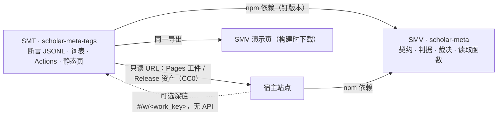
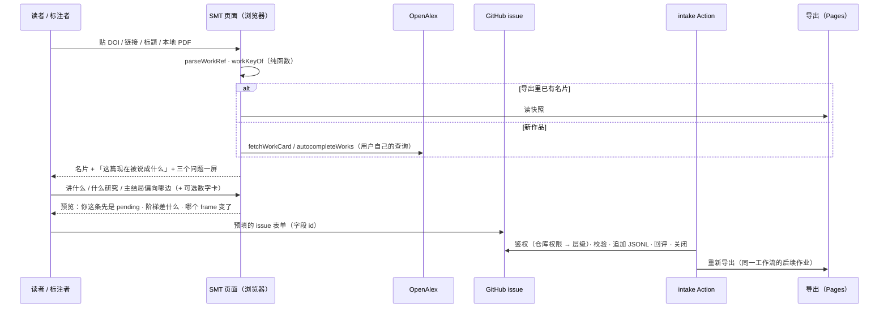
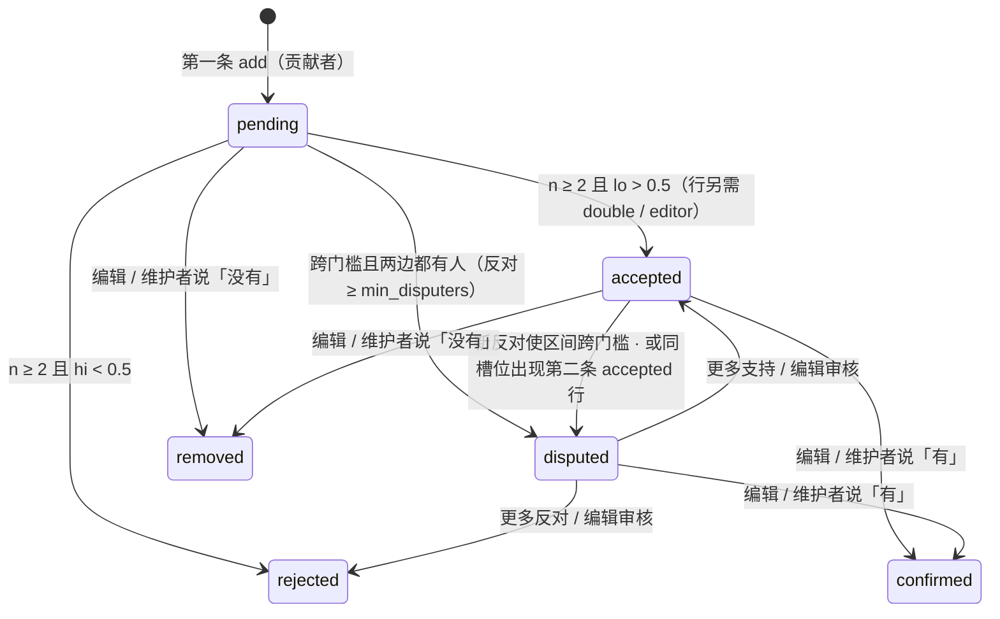
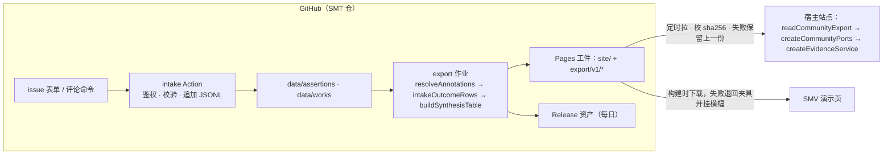

# 社区标注平台：GitHub 当数据库，引擎当裁判

设计日期：2026-10-31（wiki 先行；实现回执见文末「实现核对」）。标签的语义模型见[标签模型](Tagging-model.md)。
本页讲平台侧：SMT（`scholar-meta-tags`）怎样收断言、按 SMV 的规则裁决、发布一份按 SMV 契约成形的静态导出；以及三个项目各自的边界。全文不含任何接入方站点的名字，接入的网站一律写「宿主站点」。

## 一句话职责

| 项目 | 做什么 | 不做什么 |
|---|---|---|
| **SMV**（`scholar-meta`） | 契约 + 纯判据 + 裁决规则 + 导出读取函数 + OpenAlex 适配 + 宿主端口 / 读口 / 客户端：把「字段」变成「诚实的图」 | 不存数据、不拉导出、不认识 GitHub、不认识 SMT、不认识任何站点 |
| **SMT**（`scholar-meta-tags`） | 公共、可审计的**标注事实来源**：收断言、按 SMV 规则裁决、发布静态导出 | 不画图（调 SMV）、不托管账号（用 GitHub）、不对宿主提供在线 API、不读宿主账本 |
| **宿主站点** | 自己的文章与读者界面：实现 SMV 端口；可选地拉 SMT 导出、决定 `community.apply`、放「去标注」深链 | 不改契约、不进 SMT 仓、不依赖 SMV 未导出的东西、不解析 SMT 内部文件 |



**图表来源**：`package.json` 的 exports 与 publishConfig（SMV 发布面）；本页「导出」一节（SMT 产出的形状）；`src/ports.ts::OnsiteArticleSource / WorkTagSource`（宿主侧装配点）。

**SMT 不直接对接宿主**：宿主已通过 `OnsiteArticleSource` / `TagBindingStore` / `WorkTagSource` / `EvidenceCache` / `CertaintySource` 深度耦合，社区数据只需「多一个同形端口」；SMT 是静态仓 + Pages，没有服务进程，提供 API 就背上可用性义务；宿主账本与 SMT 裁决是**两个信任域**，合并只在宿主侧、宿主优先；CONTRIBUTING 第六节也不允许本仓放同步规则。宿主侧只做三件事：定时拉 manifest 与变了的分片、校 sha256、失败保留上一份；`readCommunityExport` → `createCommunityPorts` → 传给 `createEvidenceService`；文章页放可选深链。

## 用户流程（静态 Pages 页）



**图表来源**：`src/workref.ts::parseWorkRef / workKeyOf`、`src/openalex.ts::WorkCardResolution`（三态名片）、`src/synthesis.ts::intakeOutcomeRows / buildSynthesisTable`（表单实时验形与预览）；Action 与导出是 SMT 侧实现，本仓只提供它们调用的纯函数。

- **三种人、三种最低动作**：路人对已有标签 / 分面值点 ✓ / ✗ / ？（< 60 秒）；认真标注者答三个问题（讲什么 / 什么研究 / 主结局偏向哪边）+ 可选数字卡；编辑 / 维护者（仓库 write / maintain / admin）同一页面，提交即生效。
- **本地 PDF 不离开浏览器**：只在浏览器里提取 DOI（找不到取最长一行当标题去自动补全）。
- **预览三种状态分开说**：你这条先是 pending；阶梯级别（`describeLadderGap`）；能否汇总按 `buildSynthesisTable` 的 blockers（`unreviewed` / `dependence_unverified` / `too_few_studies`…）——即使凑够 5 篇，也要编辑核验独立性才出菱形。
- **数字卡的「认可」＝盲复录**：复录表单默认不显示原值，录完比对容差（相对 0.5% 或绝对 0.005；`n` 与 `p` 精确）；一致 ⇒ 认可 + 独立复录 +1；不一致 ⇒ 自动争议并列出差异；点「显示原值」会写进 `peeked: true`，仍计一票但不算独立复录。
- **修改** ＝ 对旧行争议（必填理由）+ 新行；两行并存都可见，由编辑定。
- **模型建议**（OpenAlex keywords / topics / mesh、标题线索）只以 model 层显示、不预选、与人类选项视觉隔开、永不计票（Sen et al. 2006 的锚定效应）。

## 数据：仓库即数据库

```
scholar-meta-tags/
├─ data/assertions/<yyyy>/<mm>.jsonl   # ★ 真源：断言，append-only，按入库月分片；>50 MB 滚片
├─ data/works/<hh>.jsonl               # 名片快照（EvidenceWorkCard，abstract 恒 null），按 sha256(work_key) 前两位分 256 片
├─ data/actors.jsonl · sample.json · REDACTIONS.md
├─ vocab/facets.json · concepts/<facet>.jsonl · tags.json · bindings.jsonl
├─ config/smt.config.json · roles.json · blocklist.json · seeds.json
├─ site/ · scripts/ · .github/ISSUE_TEMPLATE/annotate.yml · .github/workflows/{intake,export,sample,replay,check}.yml
└─ LICENSE（MIT）· LICENSE-DATA（CC0 1.0，范围见「许可与隐私」）
```

GitHub 硬约束（设计输入）：单文件 > 50 MB 警告、> 100 MB 拒绝；仓库建议 < 1 GB；Pages ≤ 1 GB、每小时 ≤ 10 次部署；`GITHUB_TOKEN` 每仓每小时 1000 次 API；并发组里只保留一个排队中的运行；**由 `GITHUB_TOKEN` 推的 push 不触发其他工作流**。容量估算：一条断言 ≈ 400–900 B，月 5 万条 ≈ 45 MB；名片 ≈ 0.8 KB，20 万篇 ≈ 160 MB；仓库到 600 MB 时把 ≥ 2 年前的月片打成 Release 资产并从 main 删除。派生导出**不进 main**（Pages 工件 + Release 资产）。

### 断言信封（一种形状，七种 kind）

```json
{"id":"a_<sha256 前 20 位>","at":"2026-10-31T09:12:03Z","work_id":"doi:10.1016/j.jad.2020.01.001","kind":"row","op":"add","subject":"row:o1",
 "by":{"kind":"person","id":"gh:1234567","tier":"contributor"},"payload":{"kind":"row","context":{…},"effect":{…},"direction":null},
 "note":null,"source":{"issue":123,"form":"annotate/1"},"supersedes":null}
```

| 字段 | 规则 |
|---|---|
| `id` | sha256 内容哈希（SMT 的 Node 侧算，SMV 不引 `node:crypto`）；同一事件重跑同 id ⇒ 幂等 |
| `work_id` | `workKeyOf(parseWorkRef(...))`：`doi:<小写>` ｜ `openalex:W…` ｜ `pmid:<n>`，优先 DOI |
| `kind` / `op` | `tag` · `facet` · `row`（add / remove）· `review`（endorse / dispute / unsure）· `binding` · `independence`（set）· `appraisal`（后三种仅编辑层） |
| `subject` | `tag:<tag_key>` · `facet:<facet_id>` · `row:<row_id>` · `binding:<tag_key>`；`review` 的 subject ＝ 被评对象 |
| `by` | `{kind, id: 'gh:<数字 id>', tier}`；`tier` 由 Action 按仓库权限**现算并冻结**：admin / maintain → maintainer，write → editor，其余 → contributor；正文自称一律丢弃 |
| `payload` | 行是**整行原子**（语境 + 效应 + 方向）；`review` 的 `re_extraction` 也是整行；贡献者提交里的 `reviewed` / `independence_verified` / `dependence_id` 入库时剥掉并记 `field_ignored` |

## 裁决：单一语义

参数全在 `config/smt.config.json`，随导出下发为 `policy`：`quorum { tier: contributor, threshold: 0.5, confidence: 0.8, min_independent: 2, min_disputers: 2 }`、`row { require_re_extraction: true, tolerance { relative: 0.005, absolute: 0.005 } }`、`min_tier { binding / independence / appraisal: editor }`。

1. 每人只算最新立场；提出 ＝ 提出者一票 add；`endorse` +1；`dispute` −1；`unsure` 不入 n。**模型断言永不计票、也不算 pending**。
2. 从最高层往下找第一个有人表态的层级（SMV `resolveWorkTags` 的既有五规则）：维护者 / 编辑层有立场 ⇒ 这一级说了算；层内一致 ⇒ `confirmed` / `removed`，不一致 ⇒ `disputed`（不投票），由另一位审核定案。**维护者的「覆盖」就是它在最高层**，没有第二套规则。
3. 只有贡献者层有立场时启用比例规则：`z = normalQuantile(0.5 + 0.8/2) ≈ 1.2816`，`[lo, hi] = wilsonInterval(k, n, z)`：`n ≥ 2 ∧ lo > 0.5` ⇒ **accepted**；`n ≥ 2 ∧ hi < 0.5` ⇒ **rejected**；跨门槛且两边都有人 ⇒ **disputed**；其余 ⇒ **pending**。两侧 80% 区间的下界 > 0.5 等价于单侧 90%。
4. **挑战规则**：反对人数 < `min_disputers` 时这些 remove 不入 n，只标 `challenged: true` 进维护者队列——单个 7 天龄账号不能把 2:0 的 accepted 打成 disputed。
5. **行的附加规则**：要 accepted 还需 `verification ∈ { double, editor }`（≥ 1 次独立盲复录在容差内一致，或编辑层提出 / 认可），否则停在 pending（`needs_re_extraction`）；同一 frame 槽位 ≥ 2 条 accepted 行 ⇒ 全部降 disputed 并标 `competing_value`；缺 `locator` 的抬级字段封顶 pending（`missing_locator`）。
6. **导出到账本立场的映射**：accepted / confirmed → `present`；rejected / removed → `absent`；disputed → `disputed`；**pending 不转成 `EvidenceWorkTag`**（账本没说），单独放在导出的 `pending` 列表里给页面与任务板。

算例（z = 1.2816）：1:0 → [0.378, 1] pending；2:0 → [0.549, 1] accepted；3:1 → [0.433, 0.922] disputed；4:1 → [0.514, 0.938] accepted；1:1 → [0.164, 0.836] disputed；1:4 → [0.062, 0.486] rejected；7:3 → [0.497, 0.846] disputed；8:2 → [0.602, 0.914] accepted。置信度旋钮（一致同意首次 accepted 所需人数 / 有 1 人反对时所需总人数）：0.80 → 2 / 5；0.90 → 3 / 7；0.95 → 4 / 8。



**图表来源**：`src/stats.ts::wilsonInterval / normalQuantile`（区间）、`src/ledger.ts::resolveWorkTags`（层级规则）；比例规则与状态词表在 0.6.0 加入 `src/ledger.ts::assessQuorum` 与 `src/community.ts::resolveAnnotations`。

## 入库、导出与工作流

| 工作流 | 触发 | 做什么 |
|---|---|---|
| `intake.yml` | issue opened / edited / labeled；issue_comment；每 15 分钟兜底；手动 | 每次运行扫全部待处理 issue：只认表单 payload 与评论命令（`/agree` `/disagree` `/unsure`；编辑层 `/accept` `/reject` `/bind`；维护者 `/approve` 放行新账号）；鉴权与层级；防滥用（账号年龄 ≥ 7 天否则 `held`、日上限扫当月与上月 JSONL、单 issue ≤ 60 条、单篇行 ≤ 20、`self_endorse` 拒、blocklist）；校验（`parseWorkRef` / `normalizeTag` / 分面词表 / `intakeOutcomeRows`）；没有名片的作品在 CI 里 `fetchWorkCard`（`error` ⇒ 标 `deferred` 等重试，外部源失败 ≠ 论文不存在）；幂等（id）；追加 JSONL；`pull --rebase` 推送失败退避重试；回评（写入几条 / 拒几条 / 状态与区间 / frame 前后）；关闭 issue。导出作为**同一工作流的后续作业** |
| `export.yml` | workflow_call；每小时；手动；push 到 `vocab/**` `config/**` `site/**` | 读全部断言（含归档）→ `resolveAnnotations` → `resolveConcepts` → 名片 + accepted 行 → `intakeOutcomeRows`（`source: 'community'`）→ `buildSynthesisTable` → `summarizeFrames` → 写 `export/v1/*`；与 `site/` 构建成一个 Pages 工件；每日另发 Release 资产；**不提交回 main**；Pages 部署按内容哈希去重且每 10 分钟最多一次 |
| `sample.yml` | 每周；手动 | 冷启动书架：`config/seeds.json` 每主题被引最高 N + 近两年 M（带 `select`，每主题 ≤ 2 credit）；名片经 `publicWorkCard` 入 `data/works/`；每篇写 model 层主题 / 关键词建议；以 PR 提交 |
| `replay.yml` | 每周 | 全部断言从头重放与最近导出逐字节比对；不一致开 issue；顺带算互相认可异常 |
| `check.yml` | PR / push | 词表（id 唯一、`broader` 无环且 ≤ 3、`design` ＝ 引擎常量、orphan 概念）、JSONL 可解析、无邮箱、文件 < 50 MB、`card.abstract === null`、导出能被 `readCommunityExport` 零问题读回；复用 SMV 的私有词闸 |



**图表来源**：SMT 侧工作流（计划）；SMV 侧 `src/community.ts`（0.6.0 加入）与 `src/service.ts::createEvidenceService`。

## 导出（SMT 产、宿主与演示页消费）

`export/v1/manifest.json`：`contract`、`export_version: 1`、`generated_at`、`source_commit`、`label`、`license: 'CC0-1.0'`、`repository`、`policy`、`facet_vocab`、`concepts_version`、`maintainers`（公开登录名，仅页面文案）、`shards[{ path, bytes, sha256, works }]`、`counts`。
`export/v1/works/<hh>.jsonl` 一行一个 `EvidenceCommunityWork`：`work_id`、`aliases`、`card`（abstract 恒 null）、`tags`（只含 present / absent / disputed 的 `EvidenceWorkTag`，带 `quorum`）、`pending`、`facets`、`rows`（输入、解析后的语境、裁决）、`unsure`、`updated_at`。另有 `frames.json`、`bindings.json`、`concepts.json`、`queues.json`。

宿主侧合并策略（SMV 提供函数、宿主仓接线）：标签 `mergeWorkTagSources([hostLedger, community.workTags])` 先到先得（宿主账本优先），`createCommunityPorts(exp, { tagStates: 'present_only' })` 缺省只下发 present（因为 `applyWorkTags` 的 merge 模式会删掉任何非 present 的作者原标签）；绑定宿主优先、社区只补位；结果行 `reviewed = (verification === 'editor')`，`independence_verified` 只在编辑层的 `independence` 断言置 true 时为 true；记录 `source: 'community'`、`provenance.license: 'CC0-1.0'`。

## 许可与隐私

| 项 | 决定 |
|---|---|
| 代码 | MIT |
| 数据 | **CC0 1.0，范围明确**：标注事实（标签、分面、数值与出处位置、裁决）与 OpenAlex 书目快照（CC0 来源）。**不覆盖**原文引文（`quote` 只留在 issue，不进 `data/`，导出只带 `locator`）与摘要（不落盘、不进导出；`readCommunityExport` 拒非 null 摘要） |
| 账号 | 只存 `gh:<数字 id>` + 登录名快照；不存邮箱、姓名、头像、IP；CI 邮箱正则闸 |
| 抹名 | `redact` 脚本把该 id 换成盐哈希（同一人仍同一键，裁决不变）；**如实声明**公开 issue 与 git 历史里的登录名抹不掉 |
| 声明 | 「用 GitHub 账号提交即公开登录名」「名片直连会把 DOI 与 IP 发给 OpenAlex，可改用离线样本或贴进 issue 由 Action 取」「本地 PDF 不离开浏览器」。与 SMV README「只在服务端调外部源」的差异：SMT 页是**用户自己的**查询，不是读者被动暴露 |

## SMV 0.6.0 要加什么（最小加法清单）

| # | 改哪里 | 加什么 |
|---|---|---|
| M1 | `src/types.ts` | `EvidenceSourceId` 加 `community`；`EVIDENCE_FACET_IDS`、`EvidenceConcept`；`EvidenceQuorumRule` / `EvidenceQuorum`、`EvidenceWorkTag.quorum?`；`EVIDENCE_COMMUNITY_STATES`、`EVIDENCE_VERIFICATIONS`、`EVIDENCE_ANNOTATION_KINDS`、`EvidenceAnnotation`（含 payload 联合、行输入）、`EvidenceCommunityPolicy`、`EvidenceCommunityDecision`、`EvidenceDataProvenance`（`EvidenceRecord.data_provenance?`）、`EvidenceFrame` / `EvidenceFrameChange` / `EvidenceLadderGap`、`EvidenceCommunityExport*`、`EVIDENCE_COMMUNITY_EXPORT_ISSUES`；图注 `community_annotated` · `single_extraction` · `community_pending_excluded`；设置 `community.apply` / `community.minVerification` / `community.tagStates` 与组 `community`。**不加** `pending` 进 `EVIDENCE_WORK_TAG_STATES` |
| M2 | `src/ledger.ts` | `LedgerPolicy.quorum?`、`assessQuorum`、`resolveWorkTags` 在「最高表态层 ＝ quorum.tier 且无经审核立场」时按比例裁决（pending ⇒ 该标签不出现）；`resolveWorkTagsWithPending`。缺省不设 quorum ⇒ 行为与 0.5.0 逐字相同 |
| M3 | `src/stats.ts` | 不改签名；`normalQuantile` 已有；加 `wilsonInterval(k, n, normalQuantile(0.9))` 的独立参考对表 |
| M4 | `src/community.ts`（新） | `resolveAnnotations`、`matchReExtraction`、`resolveConcepts`、`publicWorkCard`、`readCommunityExport`、`createCommunityPorts`、`mergeWorkTagSources` |
| M5 | `src/synthesis.ts` | `SynthesisContext.concept_ids?` / `timepoint_raw?`；`synthesisFrameKey`、`summarizeFrames`、`previewFrameChange` |
| M6 | `src/ladder.ts` | `describeLadderGap(records, draft?)` |
| M7 | `src/onsite.ts` | `OnsiteIntakeOptions.source?: 'onsite' \| 'community'` |
| M8 | `src/service.ts` | `EvidenceServiceOptions.community?`；设置 `community.apply` 为 `tags_and_records` 时把社区记录并入标签级 / 主题级图谱（同一验形、账本、阶梯；与外部示例按键去重，社区记录优先；图注 `community_annotated`）；计数层不收 |
| M9 | `src/openalex.ts` | 已有 `fetchWorkCard`（三态）与 `autocompleteWorks`；`workCardOf` 顶层导出；`isFreeOpenAlexPath` 暂不改（单实体计费先实测） |
| M10 | `src/index.ts` | 导出 `workref` 与 `community` |
| M11 | `src/present.ts` + `src/messages.ts` | `presentWorkCard`、`presentCommunityWork`、`presentFrames` / `presentFrameChange`、`presentLadderGap`；`presentWorkTags` 识别 `quorum`；词典新增各键中英各一句 |
| M12 | `src/features.ts` + `docs/architecture.md` | `work_card`、`frame_preview`、`ladder_gap`、`community_export`、`community_records` |
| M13 | 闸 | CHANGELOG 0.6.0；API 快照人工审差异；`docs/tagging.md` / `integration.md` / README；本 wiki 两页与路由；`python tools/wiki.py build && check` |

红线：`community.ts` 零 IO、不引 `node:*`、不用 `URL`、不用 `crypto.subtle`；**不**在 `client.ts` 加拉导出的方法（client 只打宿主 API；浏览器直连第三方泄露读者 IP）；`cited_by_count` 照旧永不上效应轴。

## 真实数据怎么到宿主与演示页

- 冷启动样本由 `sample.yml` 在 CI 取（开发容器内外网不可达不影响）；样本只提供名片与 model 建议，研究设计、方向、数字必须有人抄——「真实数据」＝真实论文、真实的人抄的数。
- 宿主每小时拉 manifest、校 sha256、失败保留上一份；`community.apply` 与 `minVerification` 由宿主决定。
- SMV 演示页构建时若有 `COMMUNITY_EXPORT_URL` 就下载导出，失败或无网退回夹具并挂「合成示例」横幅；两种状态必须肉眼可分；`test/regression.test.ts` 仍用固定夹具。

## 风险与未决

| # | 风险 / 未决 | 对策 |
|---|---|---|
| 1 | 置信 0.8 下 2 人一致即 accepted，可被两个账号刷 | 账号年龄、日上限、`min_independent`、`min_disputers`、blocklist、`self_endorse` 拒、replay 的互相认可异常检测、图注 `community_annotated`、维护者随时覆盖；若出现刷票把 `confidence` 调 0.9（3 人）不改代码 |
| 2 | 冷启动大量 pending；行要盲复录才 accepted | 任务板「差一次复录」最短任务；编辑一人核即 `editor` 级 |
| 3 | 盲复录在静态页是荣誉制 | 原值默认折叠；`peeked` 写进 payload 且不计独立复录；Action 只看 payload |
| 4 | GitHub 作数据库的硬上限 | 月分片、名片无摘要、归档到 Release、Pages 部署节流、宿主 etag 缓存；20 万篇前够用 |
| 5 | OpenAlex 单实体 `/works/{id}` 计费未核实 | 先用探针实测 `x-ratelimit-credits-used` 再改 `isFreeOpenAlexPath`；页面默认先读导出快照 |
| 6 | 摘要 / 引文版权与 CC0 冲突 | 摘要只现取现显；`quote` 只留 issue；LICENSE-DATA 明确排除 |
| 7 | **未决**：`reviewed` 是否允许 `double` 算审核过 | 本设计选只有 `editor`；宿主可在 `outcomes(workId, …)` 后放宽 |
| 8 | **未决**：行的 `min_independent` 是否提到 3 | 先 2 + 必须 double；观察 3 个月 |
| 9 | **未决**：宿主是否把自家编辑裁决回流 SMT | 走已有的 `EvidenceTagContribution` 交换包，层级由 SMT 重定；0 版不做 |

依据：Cochrane Handbook v6.5 §5.5（双人提取）、§10.10、§12.2、ch.23；Buscemi et al. 2006 *J Clin Epidemiol* 59(7):697–703（单人提取错误更多）；Gøtzsche et al. 2007 *JAMA* 298(4):430–437（SMD 提取错误）；Wilson 1927 *JASA* 22(158):209–212；Brown, Cai & DasGupta 2001 *Stat Sci* 16(2):101–133；GitHub Docs（About large files · Usage limits for GitHub Pages · Using concurrency · Automatic token authentication · Get repository permissions for a user）；CC0 1.0。

## 实现核对

**引擎侧（SMV 0.6.0，提交 dc2398e）**：路由 `community-engine`。

| # | 计划 | 实现 | 差异 |
|---|---|---|---|
| M1 | 契约加法 | 全部落地（`types.ts` 末尾「社区标注」各节；`EvidenceRecord.data_provenance?`；三条图注；三个设置项与组） | `EvidenceCommunityDecision` 多了 `value`、`independence?`；导出 issue 码去掉了 `shard_missing` / `shard_hash_mismatch`（引擎不校哈希，宿主拉文件时校） |
| M2 | `LedgerPolicy.quorum` / `assessQuorum` / `resolveWorkTagsWithPending` | 落地；不设时逐字不变（tagging 测试未改） | 无 |
| M3 | 独立参考对表 | `normalQuantile` 对 scipy 值；Wilson × z 对独立闭式实现（math.erf 二分反解）9 组 + 旋钮表 | 用的是独立闭式实现而不是 statsmodels（容器无该库） |
| M4 | `community.ts` | `resolveAnnotations`、`matchReExtraction`、`resolveConcepts`、`publicWorkCard`、`readCommunityExport`、`createCommunityPorts`、`mergeWorkTagSources`，另加 `reconcileRows`（竞争值在导出时做，因为需要原始行）与 `communityStateToWorkTagState` | 竞争值从 `resolveAnnotations` 内部移到 `reconcileRows` |
| M5 | frame 键与预览 | `synthesisFrameKey`、`summarizeFrames`、`previewFrameChange`；`concept_ids` / `timepoint_raw` | 无 |
| M6 | `describeLadderGap` | 落地 | 见 Tagging-model 的核对 |
| M7 | `OnsiteIntakeOptions.source` | 落地；审阅门槛只管 onsite | 无 |
| M8 | 服务 `community` 端口 | 落地：`tags_and_records` 并入标签级与主题级图谱，同 DOI / 编号去重留社区记录；`tags_only` 由宿主 `mergeWorkTagSources`；端口抛错 ⇒ unavailable | 无 |
| M9 | OpenAlex 名片与自动补全 | `fetchWorkCard`（三态）、`autocompleteWorks`、`workCardOf` 顶层导出；`isFreeOpenAlexPath` 未改（单实体计费待探针） | 无 |
| M10–M12 | 导出、展示、词典、功能登记 | 落地；功能五项（`community_records` / `work_card` / `ladder_gap` / `frame_preview` / `community_export`） | 无 |
| M13 | 闸 | CHANGELOG 0.6.0、API 快照（只增不删）、回归快照新增一组、接入指南 8 / 9 节、打标签文档第 9 节、README、两页 Wiki 与路由、`pnpm check` 本机全绿 | 首次推送的 CI `check` 在旧版导航索引快照上失败（`wiki_route.py --check` 的 `snapshot_stale`），本次提交重建索引 |

**平台侧（SMT）**：骨架已就位——`config/`（裁决参数、角色、黑名单、种子）、`vocab/`（分面词表由引擎常量生成、概念词表起步、标签别名、绑定）、`data/` 占位、`.github/`（issue 表单、intake / export / sample / replay / check 工作流）、`LICENSE-DATA`、README / AGENTS；`scripts/` 与 `site/` 的实现回执见下方补记。

**宿主**：交接文件已作为文件交给维护者（不进仓）；三方边界结论：SMT 与宿主零直接接口。演示页换真实数据（§真实数据）待 SMT 有导出后做（TODO R15）。
