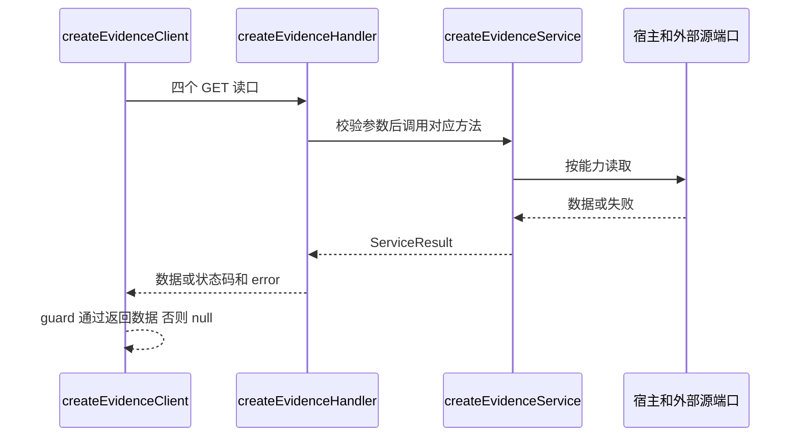
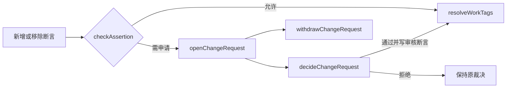

# 接口影响地图

本页记录当前实现的接缝，不是新接口设计。源码位置由 [工程路由](Engineering-entry.md) 即时解析；每节同时给声明、实现、下游、规则与验证。以下测试是改动时应跑的检查，不代表未来改动已通过。

## 外部文献源端口

- 声明：`src/ports.ts::ExternalEvidenceSource`、`ExternalNodeBundle`，数据形状在 `src/types.ts`。
- 实现：`src/openalex.ts::createOpenAlexSource`；分组计数由 `src/openalex-counts.ts::fetchEvidenceCounts` 负责。
- 下游：`src/service.ts::createEvidenceService` 组合到 getTagMap/getNodeMap/getCounts；前端消费 EvidenceMapData / EvidenceCountsData，不直接消费外部 API JSON。
- 必需能力：id、suggestTopics、nodeBundle、sampleWorks；可选能力：children、counts、topicsForDois。新增源不能假定所有可选方法都存在。
- 规则：null 是取数失败，成功空数组是没有结果；sampleWorks 是示例，counts 才是声明范围的全量计数；partial 分类包不能写长缓存。
- 改动影响：端口声明 → 适配器 → 服务能力降级 → guards/present → 契约和快照。不要只实现一个 HTTP 请求便宣称新源可用。
- 检查：`pnpm exec jest --runInBand test/service.test.ts test/openalex.test.ts test/openalex-counts.test.ts test/integration.test.ts`。
- 边界：类型中列出来源不代表适配器已实现；当前只有 OpenAlex 实现。新源真实返回与配额仍需另做 live 验证。

## 外部请求、预算与限流

- 声明/实现：`src/openalex.ts::OpenAlexOptions`、`createOpenAlexClient`、`isFreeOpenAlexPath`；这是外部请求层，不是 HTTP 读者路由。
- 下游：createOpenAlexSource 及其计数请求；有效设置由 settingsReader 接入，记录 credit 的回调是 onCredits。
- 规则：密钥由宿主注入，仅服务端；失败不伪装成空集；budget 是实例内 UTC 日统计，直接不传则不限额；并发和多实例不是全局硬限额。
- 改动影响：新增取消、重试、共享预算等能力时，需要先设计宿主端口，保持 `src/` 无运行时依赖、无 process/node 引用；浏览器不能运行时依赖此层。
- 检查：`pnpm exec jest --runInBand test/openalex.test.ts test/openalex-counts.test.ts test/settings.test.ts`；再跑 `pnpm check:boundary` 与 `pnpm build`。
- 边界：此页不声称存在共享预算端口或新取消接口，也不保证第三方今天的费用。

## 宿主依赖与注入

| 声明（均在 src/ports.ts） | 关键操作 | 谁依赖它 / 失败意义 |
|---|---|---|
| OnsiteArticleSource | listArticles({ tagKeys? }) | 服务文章读取，必须含公开文章及账本新增标签的召回 |
| TagBindingStore | get / listByTopic / put，getMany 可选 | 服务主题绑定；不能与论文标签账本混淆 |
| EvidenceCache | get / set，delete 可选 | 外部缓存与派生图；缓存故障不等于没有研究 |
| WorkTagSource | forWorks | 服务应用裁决；不可用不能退回原始标签凑数 |
| CertaintySource | forScope | [] 无评级；null/抛错取不到评级；不自动评 GRADE |

装配点是 `src/service.ts::EvidenceServiceOptions`、`createEvidenceService`。对应内存实现也在 ports.ts，标签账本存储另在 `src/ledger.ts::TagLedgerStore`。内存缓存不是数据库或分布式一致性保证。

更换存储通常只需宿主实现端口，不需要改公共契约；新增引擎能力才考虑端口扩展。缓存失效、事务和身份授权需要写清宿主责任。检查：`pnpm exec jest --runInBand test/ports.test.ts test/service.test.ts test/sync.test.ts`。真实数据库事务不能用内存测试证明。

## 公共服务、HTTP 与客户端

声明：`src/service.ts::EvidenceService`、`ServiceResult`、`ServiceError`。HTTP 实现：`src/http.ts::EVIDENCE_ROUTES`、`createEvidenceHandler`。客户端：`src/client.ts::EVIDENCE_CLIENT_ROUTES`、`createEvidenceClient`；验形在 `src/guards.ts`。

精确返回和参数见[接入与 API](Integration-and-API.md)。规则：服务 data/error 联合、HTTP 数据正文与状态、客户端 data/null 是三种不同边界；四个公共读口不承载编辑写入。改错误模型必须检查三层，并保持现有调用者兼容；不能只改类型或把全部失败变成“零研究”。

检查：`pnpm exec jest --runInBand test/http.test.ts test/integration.test.ts test/features.test.ts test/api-surface.test.ts`。package 检查另验证安装后链路。客户端 guard 验形通过不等于真实第三方数据已核实。

## 标签键与主题绑定

定位：`src/tags.ts::normalizeTag`、`groupTags`、`resolveTagBinding`、`createCuratedBinding`、`MACHINE_BINDING_POLICIES`；服务编辑方法在 `src/service.ts::EvidenceService` 的 suggestBindings/curate/bindingQueue。

两类键不能混淆：论文标签键由归一得到，主题键是 source:external_id。归一不是语义同义词合并；编辑确认/否决优先于机器候选，机器结果保留未确认出处。

归一规则变化会同时影响文章查询索引、绑定键、账本 tag_key、缓存键、共现和历史断言。不能只更新 normalizeTag 就发布；先定义键迁移和冲突策略，再检查原存储键与新查询是否一致。当前没有自动历史键迁移工具。

检查：`pnpm exec jest --runInBand test/tags.test.ts test/service.test.ts test/onsite.test.ts test/regression.test.ts`。模型标签验形和账本裁决另走下面两节，不在主题绑定函数内完成。

## 模型接口与贡献包

定位：`src/tagging.ts::EvidenceTagger`、`runTagger`、`normalizeWorkId`、`buildTagContribution`、`validateTagContribution`、`createVocabularyTagger`。交换数据类型在 `src/types.ts::EvidenceTagContribution`。

调用链：宿主模型 → runTagger 验形 → 贡献包（可选）→ 收包方验形 → ledger.submitSuggestions → 裁决 → 服务图谱。模型建议本身不等于 present 标签；归一与置信门槛后仍要经过账本策略。

规则：null 为失败，空建议为成功空结果；词表 null 与 [] 含义不同；版本要保留；贡献包验形不是账号认证。当前置信度 null 不会仅因数字门槛被排除，要改成“缺值拒收”就是行为变化。

检查：`pnpm exec jest --runInBand test/tagging.test.ts test/sync.test.ts test/api-surface.test.ts`。不能凭受控词表基线测试宣称外部模型质量合格。

## 裁决规则与审核状态

定位：`src/ledger.ts::LedgerPolicy`、`DEFAULT_LEDGER_POLICY`、`resolveWorkTags`、`checkAssertion`、`openChangeRequest`、`decideChangeRequest`、`withdrawChangeRequest`、`TagLedgerStore`、`createTagLedger`。

规则说明见[标签与裁决账本](Tags-and-ledger.md)。最高有效层级、断言者最新立场、同级争议、经审核立场优先和禁止自审必须一起评估。不要把“改最低置信度”误当成只改一个默认数字：它可能改变历史断言当前生效结果。

这是决策流程，不宣称数据库事务已实现。修改审核规则还需检查存储原子性、身份来源及重复请求策略；这些未知项不能从函数名推断。检查：`pnpm exec jest --runInBand test/sync.test.ts test/tagging.test.ts test/settings.test.ts`。

## 裁决怎样进入文章与图谱

定位：`src/ports.ts::WorkTagSource`、`OnsiteArticleSource` → `src/ledger.ts::applyWorkTags` → `src/service.ts::createEvidenceService`。`onsite.reviewGate` 是另一条筛选规则，实现在 `src/onsite.ts::applyReviewGate`。

当前服务内部 `onsiteRecords` 的顺序：先召回文章 → 验形 → 取账本结论 → 按 merge/ledger_only 应用 → 按生效标签筛选 → 应用审阅门槛并统计 pending → 下游计数/图谱。路由同时定位这个内部函数，避免只跳到数百行的服务工厂开头。它不是公开导出；只用于维护服务实现，宿主不能调用它。

规则：只从旧 tags 查询会漏掉仅账本新增的标签；disputed/absent 不计入；账本失败不是允许回退的空账本；资格变化后还要处理服务与 HTTP 缓存。检查：`pnpm exec jest --runInBand test/sync.test.ts test/service.test.ts test/onsite.test.ts test/integration.test.ts`。

## 配置接口与热更新

定位：`src/settings.ts::EVIDENCE_SETTINGS`、`validateSettings`、`createLiveSettings`、`ledgerPolicyFromSettings`、`settingsReader`；契约在 `src/types.ts::EvidenceSettings`，展示清单由 `src/manifest.ts::buildPluginManifest` 构建。

设置不是只改默认值：类型 → 注册表 → messages 中英文 → manifest → 消费入口 → 缓存/同步时机都要对应。有效 provided 值优先于代码选项；live 同步路径可能先用旧值；方法门槛不是普通设置。

检查：`pnpm exec jest --runInBand test/settings.test.ts test/features.test.ts`，然后 `pnpm build` 核对清单；刻意新增设置须重新生成 manifest。此处不提供不存在的后台存储 UI。

## 对外导出与规则变更

定位：`src/types.ts::EVIDENCE_CONTRACT_VERSION`、`src/features.ts::EVIDENCE_FEATURES`、`src/index.ts` 与五入口 `package.json` exports / publishConfig。API 快照是运行时导出，不能代替 TypeScript 类型兼容检查。

接口改动清单：契约字段/联合 → 声明与实现 → guards → present/messages → 功能表/路由 → 包入口 → 类型与行为快照 → CHANGELOG/迁移 → Wiki。按改动实际涉及部分处理，不为纯文档修改升级契约版本。

现行版本规则以[贡献规则](../../CONTRIBUTING.md)第三、四、七节为准：契约只做加法；0.x 破坏性变更随次版本并写迁移；公开接口或行为变化更新 CHANGELOG；改 types.ts 更新契约版本。不要为消除测试失败直接无审阅地更新快照。

检查：`pnpm exec jest --runInBand test/api-surface.test.ts test/regression.test.ts test/features.test.ts test/contract-tables.test.ts test/release.test.ts`，并做 `pnpm typecheck:src`、`pnpm check:package`。完整发布前检查是 pnpm check；Windows 的已知检查运行限制见[维护记录](Troubleshooting-and-maintenance.md)。
