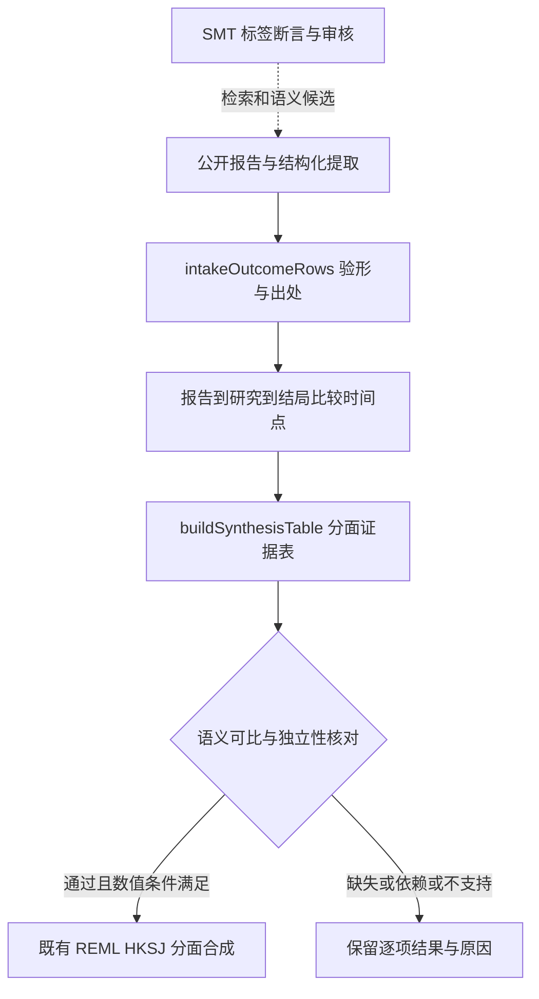

# 多结局、复合指标与有意义的证据表

更新：2026-10-21。**已实现的是结构化数据收口、表格/分面视图模型和合成闸；没有实现任意全文的可靠自动提取。** SMV 与 SMT 共用本页，SMT 的标签与断言帮助找到、解释和审核材料，不直接把语义标签变成效应量。

## 入口、输出与责任

路由：`python tools/wiki.py query synthesis-table --limit 1`。`src/synthesis.ts` 的 `intakeOutcomeRows` 消费公开文章和结构化结果，用 `intakeArticle` 做已有验形，产出既有 `EvidenceRecord[]`、语义上下文和问题列表；`buildSynthesisTable` 消费它们，产出行、分面、报告/研究/结果计数、阻止合并的原因及可选分面汇总。消费者示例是 `demo/src/synthesis.ts`；运行 `pnpm demo` 后打开 `demo/dist/synthesis.html`。全部示例数值是合成测试输入。

这是主入口上的编辑侧纯函数，没有新 HTTP 路由、不出网、不写库。网站负责鉴权、存储、全文许可、模型提取、真实审核人与版本记录。公开前先落实网站自己的公开/审阅门槛，不能把 SDK 上的 reviewed 布尔值当身份验证。

本地流程图是补充；共享系统六视图仍见 [System-views](System-views.md)。关系箭头不代表 SMT 已经自动提取全文或已有写入接口。

## 为什么不能“一篇一值”或“全站一个分数”

一份报告可能含多项研究，一项研究也可能有多份报告；一个研究又可能报告多个结局、比较、时间点与调整模型。`record_id` 标识结果行，`report_id` 标识报告，`study_id` 标识研究，`dependence_id` 标识共享参与者/对照/重复报告的依赖群。它们各司其职，不能用 DOI 同时冒充四种身份。

每条结构化输入有稳定 `id`、原文 `locator`、`effect` 与 `context`。收口强制 report_id 来自已验形的原文章；重复结果 ID 全部拒收。无结果数组时保留文章级元数据；有数组的行没有 effect 时不继承文章总 effect，避免把一项效应复制到所有结局。每份报告最多 500 条结果，超限整批拒收并给原因。

分面键包含结局、人群、比较、时间点、单位、调整口径、数据类型、研究设计、效应度量及方向。这些是审核后的**精确编码**，不会按标签相似度或模型置信度自动合并。`overall` 固定 null。报告数、研究数和结果行数分别返回，不把每行样本量相加当独立总 N。

## 各类材料怎样进入表和图

| 材料/数值 | 保留什么 | 可以表达 | 当前合成边界 |
|---|---|---|---|
| RCT / 非随机对照 | 干预、对照、结局、时间、设计、调整、效应与 CI | 同口径点线/森林分面 | 设计分开；语义审核、独立性及数值闸全通过才合成 |
| 队列 / 病例对照 / 横断面 | 暴露/比较、调整变量、人群、时间、关联量 | 关联分面 | 不翻译为因果；不同调整口径不混 |
| 连续变量 | MD 的原单位；SMD 等标准化定义与方向 | 点估计/区间 | 相同 metric 仍需同一构念；不自动把不同量表转换成 SMD |
| 二分类 | 事件定义、分母、比较方向、OR/RR | 比值量分面 | OR/RR 不混；无基线风险不自动转绝对风险/NNT |
| 生存资料 | HR、随访、事件定义 | HR 分面 | 不与 RR/OR 合并；非比例风险需另评估 |
| 有序/量表 | 编码、量表范围与方向、估计方法 | 分层表/支持的效应 | 相同单位不证明量表可比；由审核给明确编码 |
| 发生率 / 人时 | 事件数、暴露时间、单位 | 描述表 | 当前无率比专用分析，不把 rate 塞成 rr |
| 相关性 | r、对象、调整、区间 | 关联分面 | 原尺度/分析变换用现有度量；不与 MD 混 |
| 多臂 / 聚类 / 交叉 / 重复测量 | 共享对照、簇、配对与协方差出处 | 分面/依赖标注 | 当前没有多变量/稳健方差/网络 meta 模型；不要凭行数给独立性 true |
| 病例报告/病例系列 | 个案、背景、观察 | 叙述/资料表 | 不作本模块的研究间合成；无效应时不造数 |
| 定性 / 混合方法 | 主题、引文定位、语境；定量部分另拆 | 主题矩阵、证据表 | 不把主题频数当效应；mixed_methods 本轮不合成 |
| 系统综述 / meta-analysis | 纳入研究、检索期、汇总量、重叠范围 | 单独的综述层 | 不与原始研究混池，避免重复计入 |
| 协议/评论/方法/书章/政策/非研究文章 | 出版物形态、声明、方法/引用功能 | 元数据/引用图/方法对照表 | 出版物形态不是研究设计；没有结果就是没有 |
| 预印本 / 更正 / 撤稿 / 多版本 | 版本链、时间、撤稿标记 | 明确版本状态的表 | 原文去重与版本合并由宿主；撤稿不进入新收口 |
| 无法分类 / 未支持类型 | 原有元数据和未识别原因 | 资料表 | 不承诺覆盖所有新文类或从缺失推断零 |

## 多个数据表达“一个值”

要先分清：① 同一研究多次测量；② 同一构念的多个量表；③ 不同维度组成的复合指数；④ 多项独立研究估计同一目标。只有④在可比和独立条件下能走当前研究间合成。①②需要预先选定规则、合法转换或处理协方差；③需要量纲转换、权重依据、公式、验证和缺失策略，不能直接加权不同单位。

`components` 保留组成名称、原值、单位与可选权重，`formula` 保留声明；本轮只展示、不执行公式、不推算复合 CI，复合行不合并。真实研究申报的已验证复合结局若要可合成，后续应增加“构念/工具/验证版本/算法/方差”契约，而非把 kind 改成 continuous 绕过边界。图上宜用分面、组成明细和可展开来源；先解释轴、单位、分母与适用人群，再决定有没有汇总菱形。

## 实现闸与局限

缺必填上下文/出处、重复行/上下文、未审、独立性未核对、撤稿、未知设计、复合/定性/元数据类型均阻止合成；同分面 study_id 或 dependence_id 重复也阻止。允许的设计限定 rct、non_randomised_controlled、cohort、case_control、cross_sectional；数据类型与度量也要匹配。其后才运行已有 assessPooling / poolEvidence 的方差、方向、数量和 REML/HKSJ 数值闸。

这是“形式与配置足够”的计算条件，**不是临床可比性、提取真实性、偏倚风险或证据确定性认证**。自由文本上下文的真实正确性仍靠有出处的提取与审核。既有 `poolEvidence(records)` 直接入口不具备这些新语义字段，不能把它单独当完整方法学审核；网站集成多结局时应走新表。新闸没有偷偷更改旧服务返回结果。

检验：`pnpm exec jest --runInBand test/synthesis.test.ts test/features.test.ts test/api-surface.test.ts`；24 个新案例覆盖拆行/非公开/撤稿/重复/缺失、不同比较/时间/单位/结局、人群、共享研究/参与者、复合与不支持设计。安装包验收也实际消费两个新增函数。浏览器演示应核对独立情景有两个不同结局汇总，切到共享参与者后两者都停止汇总而逐项数据仍在。

方法依据：[Cochrane 第6章](https://www.cochrane.org/authors/handbooks-and-manuals/handbook/current/chapter-06)（数据类型、度量与分析单元）；[第23章](https://www.cochrane.org/authors/handbooks-and-manuals/handbook/current/chapter-23)（非独立设计与多臂）。这里的具体字段、保守默认及 UI 是本项目设计；不是文献承诺支持任意复合总分。

后续：全文许可与分段出处 → 提取候选 → 二次核对/审核 → 研究/版本去重 → 接入新表。协方差模型、复合结局运算、IPD/网络 meta、诊断准确性二变量模型与自动偏倚/GRADE 均未实现；见 [TODO](TODO.md) 与 [文刊集成交接](Publication-integration-handoff.md)。
