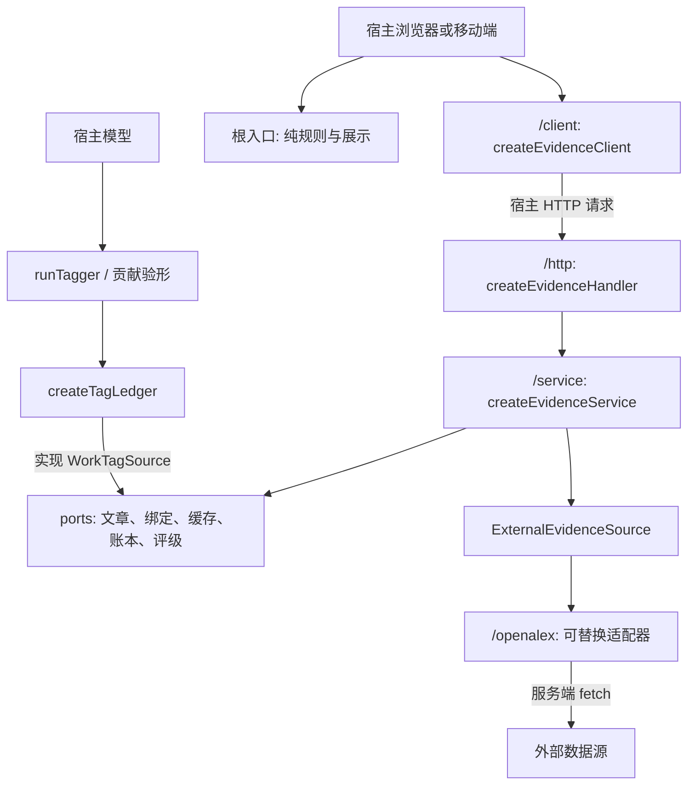
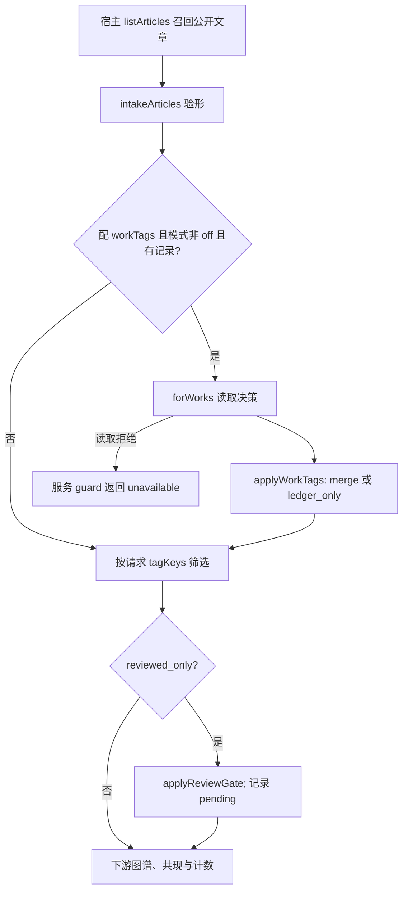
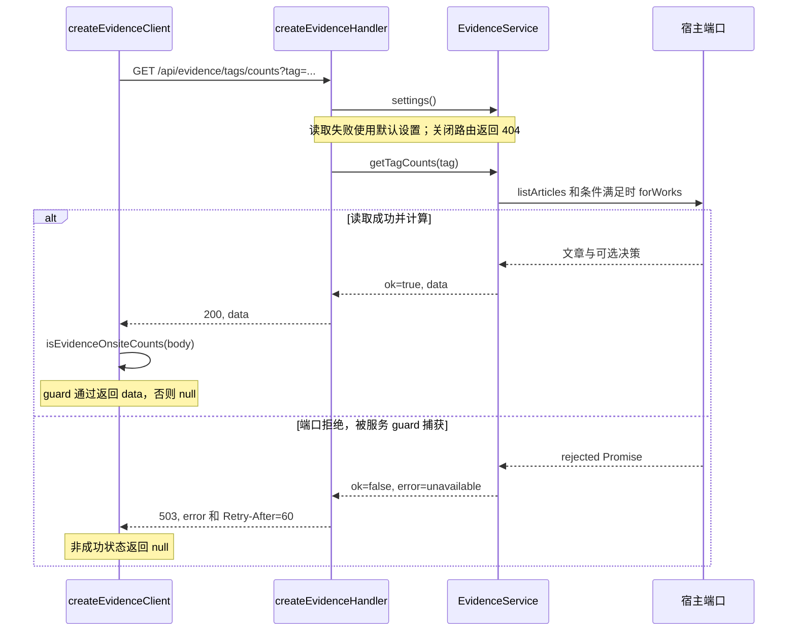
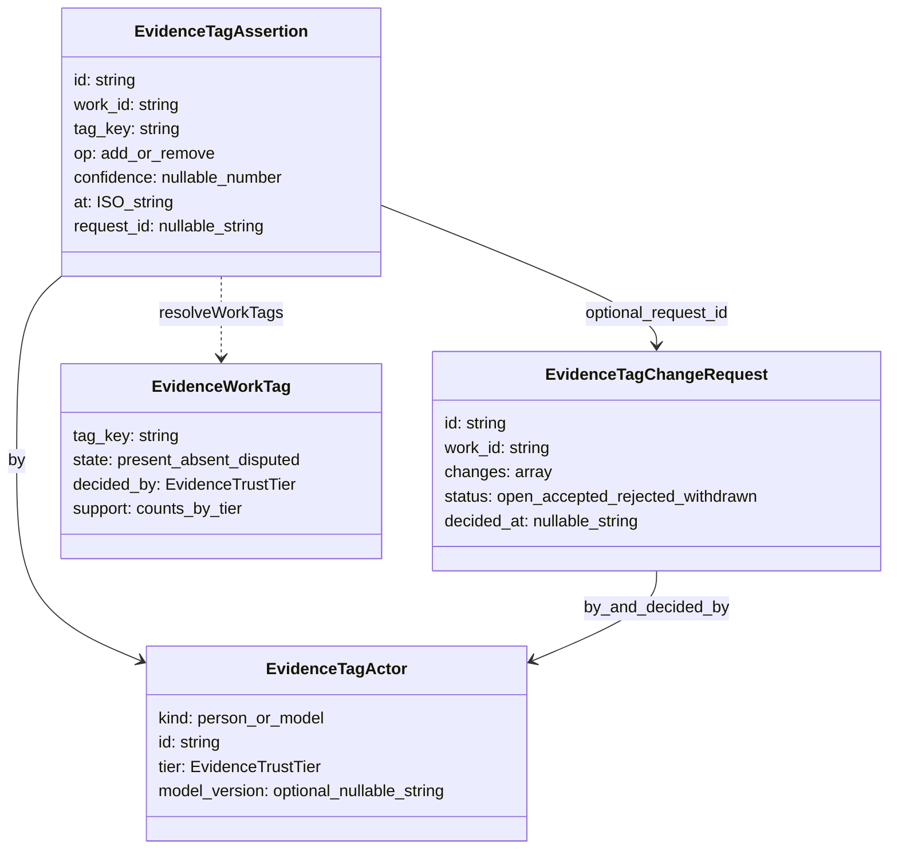
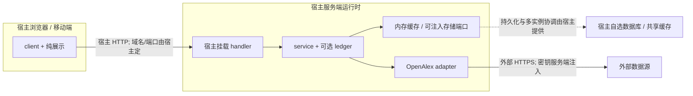
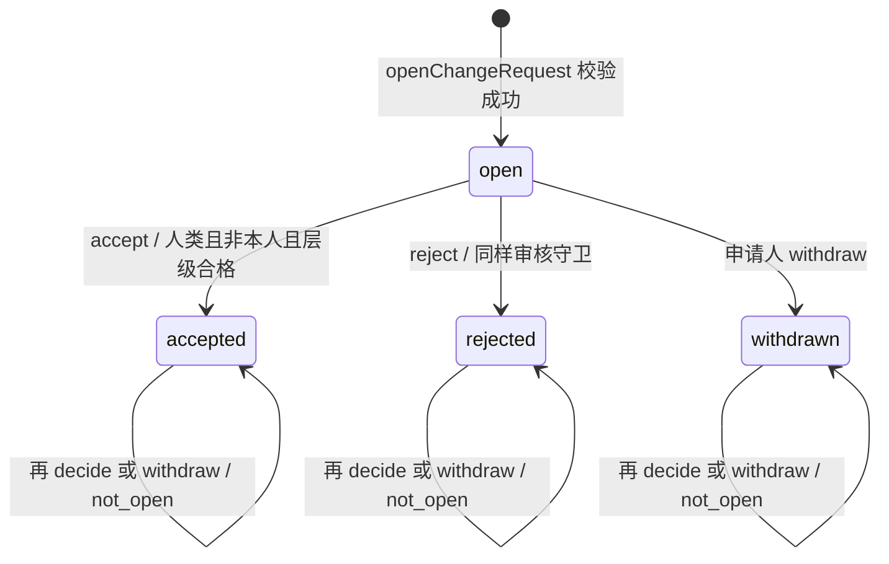

# 六视图：从系统边界到标签裁决

本页基于源码提交 `37584593a5805fc197531dbc4e58ba60fcd530e0` 定点核对，复核日期 2026-10-15。图中的宿主是通用接入责任，未验证任何具体线上部署。SMT 当前只是共享文档入口，没有独立实现或进程。按问题进入对应视图；接口契约见[影响地图](Interface-map.md)，当前行号见[生成路由索引](route-index.md)。

## 架构：五入口与注入边界

**图表来源**：`src/client.ts::createEvidenceClient`、`src/http.ts::createEvidenceHandler`、`src/service.ts::createEvidenceService`、`src/ports.ts::ExternalEvidenceSource/WorkTagSource`、`src/openalex.ts::createOpenAlexSource`、`src/tagging.ts::runTagger`、`src/ledger.ts::createTagLedger`。路由 `system-views` 定位本图；相关细节分别走 public-api / external-source / host-ports / tagger-contribution。

模块箭头不等于独立服务。根入口是否允许依赖某代码，以实际导出和 boundary 检查为准。宿主模型到贡献、贡献到账本是可组合的调用路径，不表示引擎已托管模型或自动公开收包服务。

## 流程：账本标签怎样进入统计

**图表来源**：`src/service.ts::onsiteRecords`、`guard`；`src/ledger.ts::applyWorkTags`；`src/onsite.ts::applyReviewGate`，路由 ledger-integration。guard 仅指服务工厂包裹的数据方法，不包括任意宿主调用。

召回必须先包含仅账本新增标签的文章；引擎不能补回宿主没返回的行。`onsiteRecords` 实际把非数组 rows 当作 `[]` 验形，不能笼统声称所有非法端口返回都会 unavailable。账本读取仅在条件满足时发生。cache 命中可能复用派生结果，图中展示重新计算路径；资格、标签或策略变化后的失效由接入方案处理。

## 时序：公共读口的三种失败边界

**图表来源**：`src/client.ts::createEvidenceClient`、`src/http.ts::createEvidenceHandler`、`src/service.ts::getTagCounts` 方法实现、`onsiteRecords/guard`、`src/guards.ts::isEvidenceOnsiteCounts`。路由 public-api 定位服务/handler/client，ledger-integration 定位内部召回。此图只展开合法参数、开启路由且进入服务重算的路径；完整状态码见[API](Integration-and-API.md)。

服务 `ServiceResult`、HTTP 状态与 SDK `data/null` 不同。SDK 不暴露细分错误码，也没有健康握手、前后台轮询、增量游标或订阅生命周期；这些需宿主自行设计，不能从参考 wiki 移植成“已有功能”。处理分发异常由 handler catch 返回 500；设置读取另有 catch 使用缺省。宿主 log 回调自身抛错不受“所有异常必转换”的保证。

## 数据模型：断言、申请与派生结论

**图表来源**：`src/types.ts::EvidenceTagActor/EvidenceTagAssertion/EvidenceTagChangeRequest/EvidenceWorkTag`，`src/ledger.ts::resolveWorkTags/TagLedgerStore`。这是类型和语义关联，不是数据库 ER、外键约束或存储表设计。

| 字段 / 权威 | 类型、单位与语义 | 改动影响 |
|---|---|---|
| Assertion.work_id / tagging.normalizeWorkId | string；来源前缀键或 DOI 键 | 写入、批读取、DOI 别名召回 |
| Assertion.tag_key / tags.normalizeTag | string；归一键，不做语义合并 | 索引、绑定、历史断言、缓存迁移 |
| Assertion.confidence / types + resolveWorkTags | number 或 null；0–1 由写入/模型验形约束；null 不因数值门槛排除 | 模型门槛改变历史有效立场 |
| Assertion.at、id / ledger.later | ISO 时间字符串比较；同 at 以 id 字符串定新旧 | 非规范时间/碰撞与时钟一致性是宿主责任 |
| Assertion.request_id | string 或 null；审核写入关联；不是外键强制 | 同层经审核立场优先 |
| WorkTag.state | present / absent / disputed；派生结论 | 统计仅纳入有效标签 |

表只列改接口时关键字段，完整形状以 `src/types.ts` 为权威，不复制一套完整 schema。贡献包另用 `EvidenceTagContribution` 和 validateTagContribution，不能把它与存储断言混为一谈。

## 部署：支持的接线，非线上实测

**图表来源**：`package.json::exports/publishConfig`、`src/client.ts::EvidenceClientOptions`、`src/http.ts::EvidenceHandlerOptions`、`src/service.ts::EvidenceServiceOptions`、`src/openalex.ts::OpenAlexOptions`。路由 system-views / compatibility / host-ports。虚线是可选接线责任，没有声明本仓启动了数据库或部署了主机。

五个入口是模块，不是五个进程。源码 package engines 声明 Node >=20，不等于任意宿主运行时均经部署验证。内存实现不持久、不保证多实例预算或事务。本仓没有 SMT 独立服务；具体 TLS、鉴权、端口和存储 schema 留在宿主工程。

## 状态：修改申请与标签结论分开

**图表来源**：`src/ledger.ts::openChangeRequest/decideChangeRequest/withdrawChangeRequest/createTagLedger`，`src/types.ts::EVIDENCE_CHANGE_REQUEST_STATUSES`。状态指纯规则返回的申请值；持久化成功另有边界。路由 ledger-policy。

| 当前 / 操作 | 守卫与结果 | 副作用 / 拒绝 |
|---|---|---|
| 未创建 / open | person、作品键/标签合法、非空 changes/reason | 生成 open 值；门面 putRequest |
| open / accept 或 reject | person、非申请人、达到 reviewTier 和所涉当前结论层级 | accept 生成审核断言；reject 不生成断言 |
| open / 无审核资格 | 按代码顺序校验 kind、自审、tier | not_a_person / self_review / insufficient_tier；不迁移 |
| open / withdraw | actorKey 与申请人相同 | withdrawn；否则 not_requester |
| 任意终态 / decide 或 withdraw | status 非 open 优先拒绝 | not_open；不迁移 |
| 门面找不到 requestId | getRequest 返回 null | not_found，不调用状态规则 |

这不是标签 present/absent/disputed 状态机；后者每次由断言和政策重新计算。没有过期、重开、自动合并或事务状态。`createTagLedger.decide` 顺序是读申请 → 读当前决策 → 纯规则 → append 审核断言（如有）→ putRequest。append 成功而 putRequest 失败可能留下部分效果；并发审核、身份真实性、幂等和原子提交仍由宿主处理。图的终态自环表示拒绝操作，未承诺存储调用零副作用或全事件形式完备性。

## 章节来源、影响与验证

**章节来源**：各图表块列出的类型/函数，加上 `src/service.ts::cached/onsiteRecords`、`src/settings.ts::createLiveSettings/settingsReader` 和 `CONTRIBUTING.md` 的公开引擎边界。由 routes.json 的 system-views 及特性路由解析当前位置；不要手工维护固定行号。源码提交链接应使用本页记录的 revision，移动行号以 helper 为准。

定点检查：`pnpm exec jest --runInBand test/http.test.ts test/service.test.ts test/sync.test.ts test/tagging.test.ts test/settings.test.ts`。实际运行结果见[本轮优化验收](Wiki-quality-review.md)，不要把存在测试文件当作测试已执行。修改接口的六项交付与依赖仍见[接口改进计划](Interface-improvement-plan.md)；本次只改文档和导航工具，没有实现其中的新 API。
