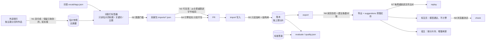

# 第一批真实规模的模型打标签

路由 `tagging-at-scale`（计划）。SMV 与 SMT 共用这一页；平台仓的事在平台仓实现，这里记目标、接缝、检测节点与回执。前一轮的地基见[检测基本盘](Verification-baseline.md)。

起点（2026-11-23）：平台账本里 40 篇、237 条断言，全是样本脚本写的模型建议；贡献包入口（`pnpm bulk`）与分片写好了但没有真实的包跑过；贡献包的标签只进质量评估、页面上看不到；宿主快照是一整份 JSON，2 万篇时 50 MB。

## 做完是什么样

| 条件 | 做完的样子 | 退出证据 |
|---|---|---|
| A 批量管道 | 平台仓一个手动触发的工作流在 CI 里取至少 2000 篇公开论文的名片，用引擎的词表打标签器产出贡献包，开 PR 放进 `imports/`；合并后 `import` 工作流写入账本并导出 | PR 编号、`import` 运行号、导出清单里的作品数与断言数 |
| B 分片与规模 | 账本增长跨过分片上限，写出第二片；增长之后只追加闸、重放比对、导出读回都通过 | 各自的 CI 运行号 |
| C 页面可见 | 标注页的作品页列出账本里的模型建议，写明「模型建议、不计票」；点一下只是填进输入框，不替人表态 | 浏览器测试用例进 CI |
| D 质量表 | `pnpm evaluate` 与 `quality.json` 在有标准答案时给出每个模型的精确率 / 召回率 / F1，并另评一遍「社区裁决结果对标准答案」；没有标准答案时写「没有」 | 夹具测试；线上 `quality.json` |
| E 宿主分片存储 | 引擎提供按分片存、只下载变了的分片的刷新函数与对应的合并函数；整份 JSON 的旧接口保留 | 2 万篇合成数据的实测数字；引擎发版 |
| F 主干全绿 | 两仓 `main` 的 CI 通过；引擎公开接口变了则 CHANGELOG、API 快照、版本号同步并发版 | 运行号、发版 tag |
| G 结束对照 | 本页末尾逐条写「已实现 / 已离线测过 / 已在 CI 或线上观察」哪一档，以及没做成的 | 本页 |

## 管道与检测节点

| 节点 | 出什么事会报警 | 在哪报 |
|---|---|---|
| N1 取名片 | 外部索引没问成 ⇒ 已取到的名片保留、运行里给警告；不把「没问成」当「没有」 | `tag` 工作流 |
| N2 篇数门槛 | 打出标签的作品少于门槛（缺省 2000）⇒ 失败，不开 PR | `tag` 工作流 |
| N3 可复现 | 用仓里的名片与当前词表重算，和 `imports/` 里同版本的包不一致 ⇒ 失败 | `tag`（开 PR 前）、`import`（写入前）、`check` |
| N4 验形 | 整包不成形 ⇒ 失败，什么都不写 | `tag`（开 PR 前）、`import`（写入前）、`check` |
| N5 只追加 | 写入之后与写入之前比，旧行被改或被删 ⇒ 失败，不提交 | `import` 工作流；`check` 可手动指定基准再比 |
| N6 读回与对账 | 导出读回有问题、或旁路文件里的建议数不等于账本里当前生效的模型建议数（闸里另数一遍，不复用导出的代码）⇒ 失败 | `export`、`check` |
| N7 重放 | 线上导出任何一个文件（含旁路文件）与重放结果不同 ⇒ 开 issue | `replay`（每周） |
| N8 页面 | 模型建议没显示、没标「不计票」、或被算进票数 ⇒ 失败 | `check` 的浏览器测试 |

机器人开的 PR 不会自动跑 `check`，机器人的推送也不会触发别的工作流，所以 N3–N5 都放在写入的那个工作流自己身上：`import` 先验形、先重算，过了才写；写完先比只追加，过了才提交。

N3 的盲区（如实记着）：词表改了以后，旧版本的包不再重算（没有旧词表可比），只给提示；名片后来又存过新快照的作品不比，只记数。

## 接缝

**打标签器（平台仓，引擎函数）。** 词表就是 `vocab/tags.json`（标签键 → 显示名与别名，人维护）。打标签器是引擎的 `createVocabularyTagger`，只读仓里存着的名片字段（标题、关键词、主题名；摘要不存所以不用），所以任何人克隆仓库就能重算出同一个包。模型 id 固定，版本号里带词表内容与所钉引擎版本的哈希：词表或引擎一改就是新版本、新的包，旧包留着不动。

**一个包是模型对一篇的完整回答。** 贡献包写成的断言按（模型, 版本, 作品, 标签键）幂等；同一个模型对同一篇，只有最新版本的那一组生效——新词表不再给的标签随之退场，页面上标的版本是这一篇实际用的版本。新版本对某篇一个标签都不给时，旧的那组仍然显示（模型不能撤回），这一点记在未决里。

**引擎的词表打标签器要先修（评审发现）。** 它拿标签归一函数去归一正文，而标签归一对超过 100 个字符的回空：长标题整个不参与匹配；`/` 也不当分隔。这一轮在引擎里修（正文不设长度上限、`/` 当分隔），随 E 一起发版；平台钉新版本后再跑真实的一批。

**建议旁路文件（平台导出，不在引擎契约里）。** `suggestions/<hh>.jsonl`，与作品分片同名同分法；一行一篇：`{ work_id, models: [{ id, version, tags: [{ tag_key, label, confidence }] }] }`，只收模型层当前生效的标签建议，作品键先按名片的别名换成导出里的那个键。`suggestions.json` 记各片的条数与哈希。宿主的读取函数不读它；标注页只在打开某一篇时取那一片。模型层断言照旧不进裁决、不进作品的 `tags` / `pending`。

**质量表（平台）。** `quality.json` 在每个模型的指标之外加一节 `consensus`：把导出里状态为「成立」的标签当作预测，对标准答案算同一套指标（引擎 `scoreTagSets`）；研究设计用 `scoreLabelAgreement`。标准答案只能由人写进 `data/gold/`。

**宿主分片存储（引擎，公开接口加法）。** 宿主实现一个五个动作的存储端口，引擎负责刷新与读取：

| 名字 | 作用 |
|---|---|
| `CommunityShardStore` | 端口：读 / 写索引，读 / 写 / 删一个分片（键是不透明字符串，值是作品数组）。宿主用自己的表或键值存储实现 |
| `CommunityShardIndex` | 索引：清单、每片的存储键 / 哈希 / 作品数 / 出现过的标签键、附带文件、取数时刻，以及两张待清理的键清单（写到一半的、上一版退下来的） |
| `refreshCommunityShards` | 清掉上次留下的待清理键 → 拉清单 → 哈希没变的分片不下载 → 变了的逐片下载、核哈希、验形、写到新键 → 全部成功后才换索引。任何一步不成：索引里生效的分片清单不动，读到的还是上一份 |
| `readCommunityShards` | 按标签键只读含这些标签的分片；跨片重复的作品只留一条并记数；索引指着的分片读不到 ⇒ 如实报失败 |
| `mergeCommunityRecordsFromShards` | 与 `mergeCommunityRecords` 同一结果，数据从分片存储来 |
| `createMemoryShardStore` | 内存参考实现（测试与示例用） |

分片按内容寻址（键里带哈希），生效的清单最后才换，所以读的人看到的总是完整的一版。两处并发与中断的处理：

- **写到一半被杀**：动手写分片之前，先把要写的键记进索引的「写到一半」清单（生效清单不动）；下次刷新开头把其中没生效的删掉。端口不需要「列出所有键」。
- **有人正在读旧版**：换索引时旧键不马上删，记进「退下来的」清单，下一次刷新开头才删——正在读的请求有一个刷新周期的时间读完。清理时绝不删生效清单里的键（内容改回旧哈希时旧键会重新写一遍）。
- **跨片重复**：逐片验形看不到别的片；同一次下载的分片之间有重复 ⇒ 刷新失败；与没变的分片重复，在读取时去重并记数。要整份核对仍可用 `refreshCommunityExport`。

`refreshCommunityExport` 与整份快照的接口保留，小站照旧能用。

## 依赖

- C 的浏览器测试依赖旁路文件；A 的真实数据依赖 C 与 N3–N6 先进主干（先有检测节点再灌数据）。
- B 依赖 A 的数据量；把分片上限调小，让这一批数据真的跨过上限。
- E 与平台仓无依赖，可并行；平台仓钉的引擎版本不必跟着升。

## 八个维度

| 维度 | 这一轮 |
|---|---|
| 入口 | 手动触发的 `tag` 工作流；`pnpm tag`；宿主的定时任务调刷新函数 |
| 输入验形 | 贡献包走引擎 `validateTagContribution`；分片逐片核哈希与作品数 |
| 状态与存储 | 账本只追加、按上限分片；宿主分片存储按内容寻址、索引最后写 |
| 失败处理 | 外部源没问成保留上一份；刷新失败索引不动；整包不成形整包拒绝 |
| 展示 | 作品页「模型建议、不计票」；质量表的人话 |
| 检测 | N1–N8 |
| 文档 | 平台 README / AGENTS；引擎 `docs/integration.md`、CHANGELOG；本页 |
| 验证 | 单元与夹具测试、浏览器测试、CI 运行号、合成规模实测 |

## 这一轮做不了的

- **真人路径**：两个真实账号各提一条标注 issue 走到裁决（R18）。不替任何人发言。
- **真实标准答案**：`data/gold/` 由维护者标。质量表在此之前只能用夹具证明算得对，线上如实显示「没有」。
- **仓库规则**：平台仓默认分支禁止强推、禁止删除，要管理员在设置页建。
- **词表打标签器的准确度**：没有标准答案就没有数字；这一批只证明管道，不证明标得准。
- **模型撤回**：新版本对某篇不再给任何标签时，旧版本的建议仍显示。
- **宿主真的换存法**：引擎给接口与实测，接不接由接入方在自己的仓里定。
