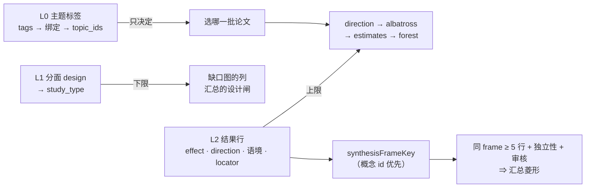

# 标签模型：一条标注怎样变成一张图

设计日期：2026-10-31（wiki 先行；实现回执见文末「实现核对」）。本页回答三个问题：标签要不要分层、哪种标注影响「选哪些论文」、哪种影响「能画什么图」。
平台侧（仓库布局、入库、裁决、导出）见[社区标注平台](Community-annotation.md)。

## 结论：三层 + 借来的层级 + 后置的概念层

| 层 | 名字 | 词表 | 谁定 | 落到引擎 | 作用 |
|---|---|---|---|---|---|
| L0 | **主题标签**（讲什么） | 开放 folksonomy；`normalizeTag` 只做正字法归一 | 任何人；模型只能建议 | `EvidenceRecord.tags` → 绑定 → `topic_ids` | **只决定选哪一批论文** |
| L1 | **分面**（是什么研究） | 封闭、小：`design` 的取值 ＝ `EVIDENCE_STUDY_DESIGNS`（CI 核对相等）；筛选分面 `population_age` / `setting` / `comparator_kind` 各 ≤ 8 值 + `unsure` | 词表由平台维护者改；取值由标注者选 | `design` → `EvidenceRecord.study_type`；筛选分面只在导出与页面筛选 | **决定级别下限**（缺口图的列、汇总的 `unsupported_design` / `mixed_designs` 闸） |
| L2 | **结果行**（数字怎么说） | 原子元组：效应（`metric` / value / ci / n / p / `higher_is_better`）+ `direction` + 结局语境（outcome / comparison / population / timepoint / unit / analysis / kind）+ `locator` | 标注者从原文抄录 | `intakeOutcomeRows` 的一行 → `effect` / `direction` + `SynthesisContext` | **决定上限**（direction / albatross / estimates / forest 与能否汇总） |
| H | **层级** | 外部主题树（topic → subfield → field → domain）+ 概念词表的 `broader`（SKOS，维护者 PR，CI 查环） | 不由用户维护 | 缩放阶梯已有；`broader` 只给页面导航 | **只导航与计数，永不参与数值合并** |
| C | **概念层**（后置） | `c:<facet>/<slug>`：label（zh / en）、aliases、broader、mappings（MeSH 等可核对 id）、结局概念带 `default_kind` / `default_higher_is_better` | 维护者 PR；用户经 issue 提议 | **导出时** `resolveConcepts` 把 L2 的自由文本语境解析成 `SynthesisContext.concept_ids`；`synthesisFrameKey` 有 id 用 id | 措辞稍异的两行最终同框；标注者永不被词表卡住 |

**方向在结果行上，不在作品上**：多结局论文整体一个方向会与各行的效应量冲突（`intakeArticle` 会把冲突的方向改成 `unclear`）。「主结局偏向哪边」就是第一行 `o1` 的最短形态。

### 上级标签要不要

| 层 | 要不要 | 来源 | 禁止用途 |
|---|---|---|---|
| L0 | **不要** | 同义 / 跨语言靠编辑把两个标签**各自**绑到同一外部主题（`createCuratedBinding`） | — |
| 外部树 | 有（四级） | OpenAlex | 不判可比性 |
| 概念词表 | 有（`broader`，允许多上位，≤ 3 级，无环） | 平台 `vocab/concepts/`，维护者 PR | **永不合并数值** |
| L1 / L2 | 无 | 封闭常量 | — |

依据：Golder & Huberman 2006（*J Inf Sci* 32(2):198–208）——扁平标签频率几十次后稳定，而人与人的「基本层级」不一致，用户造的层级必然互相矛盾；BibSonomy 把标签关系做成私有（Benz et al. 2010, *VLDB J* 19(6):849–875）。SKOS Reference（W3C 2009 §8）：`broader` 不做推理；ISO 25964-1：层级由词表编辑按成文规则维护。
Cochrane Handbook v6.5 §10.10.2 / ch.23：可比性由**一组正交的受控字段**决定（结局、比较、度量、方向、分析单元），不由一个标签决定——这正是 `buildSynthesisTable` 的分面键。

### 标签组合

- 复合标签（`adhd-children-rct`）不进 L0：页面检测到输入里含分面词表的值时提示「放到『什么研究 / 人群』里」。
- **组合是查询不是标签**：`?tag=adhd&design=rct&direction=favours` 由现成的 `applyEvidenceFilters` 在浏览器里筛，零新存储。
- 真正有方法学意义的组合是一个 **frame**（分面键元组），升格为一等公民：`synthesisFrameKey`、`EvidenceFrame`、`summarizeFrames`、`previewFrameChange`。

## 从一条标注到一张图

**图表来源**：`src/ladder.ts::pickEvidenceView`（阶梯判据）、`src/synthesis.ts::buildSynthesisTable`（分面键与闸）、`src/tags.ts::normalizeTag`、`src/onsite.ts::intakeArticle`（方向冲突规则）。

| 标注（表单字段） | 落到 | 影响「选哪些」 | 影响「能画什么」 | 必须人抄？ | OpenAlex 能预填？ |
|---|---|---|---|---|---|
| 书目（标题、年份、作者、DOI、期刊、OA、出版物形态、撤稿、被引） | 名片快照 → `OnsiteArticle` 同形字段 | 否 | 否（撤稿被入库丢掉；被引数永不上效应轴） | 否 | **是**：`fetchWorkCard`；摘要只在浏览器显示 |
| L0 主题标签 | `tags` → `tag_key`；经绑定 → `topic_ids` | **是**（唯一作用） | 否 | 人确认 | 建议：`keywords` / `topics` / `mesh`，以 model 层写入，永不计票 |
| L1 `design` | `study_type` | 是 | **是**：缺口图列；`unsupported_design` / `mixed_designs` | **是**，`locator` 必填 | **否**（`type` 是出版物形态，红线）；标题线索只以 model 层建议 |
| L1 筛选分面 | 导出 `facets`；页面与宿主筛选 | 是 | 否 | 是 | 否 |
| L2 `direction` | `EvidenceRecord.direction`（每行） | 是 | **是**：direction 级；albatross 前提 | 行无效应量时必填 + `locator`；有效应量时选填，由 `directionFromEffect` 推出，冲突就地提示 | 否 |
| L2 `metric` + `value` | `effect.metric / value` | 否 | **estimates** 级 | 是，`locator` | 否 |
| L2 `ci_low` / `ci_high` | `effect.ci_*` | 否 | **forest** 级；汇总前提 | 是 | 否 |
| L2 `n` + `p_value` | `effect.n / p_value` | 否 | **albatross** 级（≥ 2 行） | 是 | 否 |
| L2 `higher_is_better` | `effect.higher_is_better` | 否 | 汇总的 `orientation_unclear` 闸 | 概念默认 + 人确认；覆盖写理由 | 否 |
| L2 语境 outcome / comparison / population / timepoint / unit / analysis / kind | `SynthesisContext.*` + 导出时 `concept_ids` | 否 | **是**：分面键决定同框；缺一条 ⇒ `missing_or_invalid_context`（可列表不可汇总） | 是（`outcome` 必填；其余有缺省） | 否 |
| `study_id` / `dependence_id` | `SynthesisContext` | 否 | **是**：`dependent_observations` 闸 | 标注者可提议（试验注册号 / 主报告键），缺省 ＝ 作品键 | 否 |
| `independence_verified` / `reviewed` | `SynthesisContext` | — | 任一为 false 都阻止汇总 | **只有编辑层**（`independence` 断言）；贡献者提交里的这两个字段入库时剥掉 | 否 |
| 偏倚风险 / GRADE / 绑定 | `risk_of_bias` / `CertaintySource` / `EvidenceTagBinding` | 否 / 否 / 是 | 敏感性分析 / 展示 / 主题级汇总 | **仅编辑层** | 否 |
| 作者自报显著性 | `self_reported_claim` | 否 | 只喂阳性率这张文献计量图 | 社区表单**不问**（Cochrane 12.2.2.1） | 否 |

### 每级差什么（写进用户可见文案，`describeLadderGap`）

| 级 | 判据（`EVIDENCE_VIEWS`） | 页面文案 |
|---|---|---|
| gap_map | 任意 | 「这个话题有 N 篇，其中 k 篇知道是什么研究」 |
| direction | ≥ 1 行有 `direction` | 「再有 1 篇标了主结局偏向，就能画方向图」 |
| albatross | ≥ 2 行同时有 direction + n + 精确 p | 「还差 1 篇带精确 p 与样本量」 |
| estimates | ≥ 1 行有 value | 「有了点估计就能把效应摆上一根轴」 |
| forest | ≥ 1 行有 value + ci | 「加上 95% 区间就是森林图」 |
| 汇总菱形 | 同 frame ≥ 5 行有区间；设计 ∈ 五种可汇总设计；`kind` 与 `metric` 匹配；`higher_is_better` 一致；行 `reviewed` 且 `independence_verified`；无 `dependent_observations` | 「同一结局、同一比较、同一度量的 RCT 还差 2 篇；且需编辑核验这 5 篇相互独立——社区抄录本身不能出菱形」 |

三句话：**L0 只选论文**（错了只是多选少选一篇）；**L1 决定下限**（`design` 要 `locator` 与足够的人）；**L2 决定上限**（数字抄错一位比没有更糟，所以行要双份独立一致才 accepted）。

### 否决的备选

| 备选 | 否决理由 |
|---|---|
| 用户自建父子标签 | folksonomy 的层级互相矛盾（见依据） |
| 维护者手工维护全站一棵树 | 单点劳动；外部已有四级树 |
| 整部本体（SNOMED / 完整 MeSH） | 许可与体量；改为按需收录 + 记 `mappings` |
| 纯受控词表、无自由标签 | 冷启动找不到论文，也去掉了宿主已有的 folksonomy 入口 |
| 概念 id 作为入库前置条件 | 冷启动期绝大多数行「能看不能同框」，打击标注动力；改为导出时后置解析 |
| 分面值纯自由文本、永不合并 | frame 永远碎片化，「加上这篇后」永远不升级 |
| 从摘要正则抽效应量 / 让模型直接入库数字 | 绕开 `locator`，无人能核对；只能当 model 层候选，永不计数 |
| 把 OpenAlex `type` 映射成研究设计 | 出版物形态 ≠ 研究设计（`EvidenceRecord.study_type` 注释里的红线） |
| 按字段拆开投票再拼装一行 | 会把 A 的点估计与 B 的区间拼成谁也没抄过的效应量；Cochrane §5.5 双人提取的单位是**整行** |

### 风险

- 分面词表膨胀成第二个 folksonomy：`design` 必须等于引擎常量，其余分面 ≤ 8 值 + `unsure`，加值走 PR 并写 `maps_to`。
- 概念默认 `higher_is_better` 被当真理：只作表单默认值 + 行级必填确认；`assessPooling` 仍逐行查 `orientation_unclear`。
- 词表维护滞后：导出的 `queues.json` 列「提议最多的未收录值」；在此之前行仍可见、可画到阶梯级别，只是不与别的作品同框。

## 实现核对

状态：**引擎侧已实现（0.6.0，提交 dc2398e）；平台侧见 [Community-annotation](Community-annotation.md) 的实现核对。**

| 计划 | 实现 | 差异 |
|---|---|---|
| L0 标签只选论文 | 不变：`tags` → `normalizeTag` → 绑定；社区标签经 `communityStateToWorkTagState` 进账本，`createCommunityPorts` 缺省只给 present | 无 |
| L1 `design` → `study_type`，取值 ＝ 引擎常量 | 平台 `vocab/facets.json` 由引擎常量生成；`createCommunityPorts.articles` 把 accepted / confirmed 的 design 放进 `study_design` 再经 `intakeArticle` 验形 | 无 |
| L2 行是原子，方向在行上 | `EvidenceAnnotationPayload` 的 `row` 整行；`resolveAnnotations` 的认可必须带整行复录；`createCommunityPorts.outcomes` 一行一个 `intakeOutcomeRows` 输入 | 无 |
| 概念层后置解析 | `resolveConcepts` + `SynthesisContext.concept_ids`；`synthesisFrameKey` 有 id 用 id，无 id 的键逐字不变（synthesis 测试与回归快照未变） | 无 |
| 层级只借外部树与 `broader` | 引擎只在 `EvidenceConcept.broader` 里搬运，不参与任何合并；页面导航在平台侧 | 无 |
| `describeLadderGap` 文案 | 实现并有 `presentLadderGap`（中英）；「汇总还差几项」取 `assessPooling`，并注明分面闸另算 | 字段缺口只报最常缺的一个字段（表里每级一句），不逐字段列全 |
| 映射表「`independence_verified` / `reviewed` 只有编辑层」 | `createCommunityPorts`：`reviewed = (verification === 'editor')`，独立性只来自编辑层 `independence` 断言 | 无 |
| 自报显著性不问 | 社区表单无此字段；引擎端口不填 `claim` | 无 |

回归快照：既有用例未变，新增一组社区标注用例。参数与 Community-annotation 一致（`DEFAULT_QUORUM_RULE` = 0.5 / 0.8 / 2 / 2，`DEFAULT_COMMUNITY_POLICY` 容差 0.5% / 0.005）。
