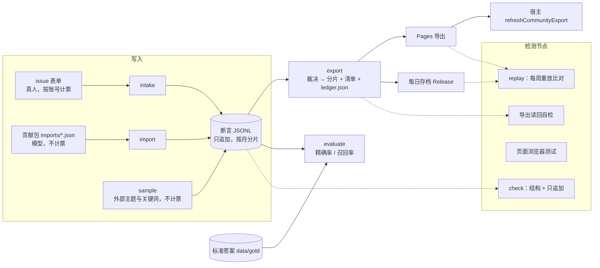

# 检测基本盘：上规模之前先能验

路由 `verification-baseline`（计划，仍有未完成的目标）；已实现的引擎部分另有路由 `tagging-quality`。SMV 与 SMT 共用这一页；平台仓的事在平台仓实现，这里只记目标、接缝与回执。

2026-11-23 对两个公开仓做了一次检查（密钥、私有词、远端分支、工作流运行、重放结果、合成规模实测）。结论：卫生基本干净、算力够用，但有七处「出了错没人会知道」的缺口。上大批量打标签之前，先把这些检测节点补上。每个缺口立一个目标，写明做完是什么样、靠什么证据算完成、哪些这轮做不了。

## 检查时的事实（2026-11-23）

| 项 | 观察 | 出处 |
|---|---|---|
| 真人断言 | 0 条；库里 237 条全是模型建议（永不计票） | 平台仓 `data/assertions/` |
| 重放比对 | 每周一次，最近两次（11-15、11-22）通过 | 平台仓 `replay` 工作流 |
| 每日存档 | 只有 `data-2026-11-01` 一份；发版条件 `startsWith(schedule, '7 3 ')` 对 `7 * * * *` 永不成立 | 平台仓 `export.yml` |
| 只追加 | 只是约定：没有闸核对旧行未被改删；主干允许强推 | 平台仓 `check.ts`、仓库设置 |
| 标注页测试 | 29 例浏览器测试从未提交；CI 只构建页面 | 平台仓 `site/` |
| 机器人开的 PR | `check` 停在需要批准，不自动跑 | 平台仓 PR #2、#4 |
| 定时频率 | 写的是每小时 / 每 15 分钟；GitHub 实际每天各触发约 4 次。issue 事件仍即时触发入库 | 平台仓 Actions 运行记录 |
| 定时保活 | 公开仓 60 天无活动会被停掉定时任务 | GitHub 规则 |
| 质量度量 | 没有标准答案集，没有任何准确率 / 一致率指标 | 两仓 |
| 批量入口 | 只有 issue（每账号每天 20 个 issue、200 条断言）与样本脚本 | 平台仓 `config/smt.config.json` |
| 单文件体积 | 断言按月一个文件；一个月进 30 万条约 100 MB，超过本仓 50 MB 闸与 GitHub 单文件上限 | 合成实测 |

合成规模实测（每篇 5 个标签、每标签 3 人）：

| 作品 | 断言 | 导出耗时 | 内存 | 导出体积 | 断言库体积 |
|---|---|---|---|---|---|
| 2 千 | 3 万 | 0.5 秒 | 163 MB | 5 MB | 10 MB |
| 2 万 | 30 万 | 4.9 秒 | 628 MB | 50 MB | 101 MB |

宿主侧 2 万篇时：`mergeCommunityRecords` 每张图约 11 毫秒，整份快照 50 MB。这些是一次本机实测，不是容量承诺。

## 数据从哪来、谁来验

## 七个目标

状态分开写：计划 / 已实现 / 已离线测过 / 已在真实环境观察。写「已实现」不等于「已观察」。

| 目标 | 做完是什么样 | 完成判据（退出证据） | 这轮做不了的 |
|---|---|---|---|
| **G1 真人路径走通** | 两个真实账号各提一条 issue，入库、按比例裁决、出现在导出、被引擎读回 | issue 编号、入库运行号、断言行里的 `gh:` 账号、导出里该标签 `accepted`、当周重放通过 | 需要两个真人账号；会话不代人发言 |
| **G2 改写能被发现** | 旧断言被改或被删时 CI 失败（声明过的抹名除外）；每天有一份带哈希的存档；主干不能强推 | 只追加闸的测试（改一行、删一行、删文件、抹名四种）；连续两天各有一份 `data-<日期>` 存档；强推被拒 | 仓库规则要管理员权限 |
| **G3 检测节点进 CI** | 标注页浏览器测试在仓里并随 `check` 跑；样本 PR 在开出之前先自检 | `check` 工作流里浏览器测试通过的运行号；样本工作流日志里的自检结果 | 机器人 PR 的 `check` 仍需人批准（GitHub 行为） |
| **G4 批量入口与分片** | 模型贡献包走 PR 进仓、与 issue 同一套引擎校验、幂等；断言文件超过上限自动开新分片 | 贡献包的往返测试（验形、幂等、坏包拒绝）；分片滚动测试；2 万篇合成数据导出读回零问题 | 真人批量（表格导入）不做：计票需要逐人身份 |
| **G5 标得对不对能量出来** | 引擎给出标签集合对标准答案的精确率 / 召回率 / F1，单选分面的一致率与 κ；平台按模型出质量表 | 与独立参考实现对表的数值测试；平台 `evaluate` 在夹具上的测试 | 真实标准答案要人标；没有答案集时如实显示「没有」 |
| **G6 频率如实、定时不停** | 文档写实际频率；每周保活一次定时任务 | 文档改动；保活步骤的运行记录 | GitHub 调度本身不可控 |
| **G7 公开仓常规件** | 安全政策、依赖更新配置、平台仓贡献规则、第三方 Action 钉到提交号 | 文件在仓；`check` 仍绿 | 已公开的个人邮箱不改历史 |

依赖：G5 的平台部分要等引擎发版后才能装；G4 的分片先于批量入口；其余互不等待。

## 八个维度（这页作为功能入口必须回答的）

| 维度 | 回答 |
|---|---|
| 目的与完成 | 让「数据被改写、页面坏了、标签标错、定时停了」都有一个会报警的节点；七个目标各有退出证据（上表） |
| 角色与权限 | 贡献者（任何 GitHub 账号，经 issue）；模型贡献者（经 PR 提交贡献包，不计票）；维护者（合并 PR、标标准答案、抹名）；读者与宿主（只读导出）。层级由入库方按仓库权限现算，包里自称不算 |
| 环境与发布 | 引擎随版本发版；平台仓推 `main` 即生效；Pages 与每日存档由工作流发布。本机通过 ≠ CI 通过 ≠ 线上观察，回执分开记 |
| 输入与输出 | 输入：issue 正文、贡献包（`EvidenceTagContribution`）、标准答案行。输出：断言行、导出分片与清单、`ledger.json`（各断言文件的字节数与哈希）、`quality.json`（各模型的指标）。不存摘要、不存邮箱 |
| 上下游 | 写入方：intake、import、sample、redact。读取方：export、replay、check、evaluate、标注页、宿主的 `refreshCommunityExport`。`ledger.json` 与 `quality.json` 不在引擎契约里，宿主读取函数不看它们 |
| 状态与失败 | 入库幂等（同一事件同一 id）；贡献包整包不成形则整包拒绝，单条坏的逐条报；导出读回有问题则不发布；存档当日已有则跳过；只追加闸失败则 `check` 红。部分成功：贡献包里部分条目被丢弃时照常入库并报数 |
| 改哪里、怎么验 | 引擎：`src/quality.ts`（度量）、`src/tagging.ts`（贡献包校验，已有）。平台：`scripts/lib/store.ts`（分片）、`scripts/check.ts`（只追加）、`scripts/import.ts`、`scripts/evaluate.ts`、`site/test/`、各工作流。窄测试见各目标的退出证据 |
| 还缺什么 | G1 与真实标准答案要人；仓库规则要管理员；机器人 PR 的检查批准是 GitHub 行为；宿主快照到 20 万篇时不能再是一整份 JSON（未设计） |

## 设计要点

**只追加闸。** 比较基准提交与当前提交里 `data/assertions/**` 的每个文件：旧内容必须是新内容的字节前缀，文件不能消失。唯一例外是抹名：同一范围内 `data/REDACTIONS.md` 有新增行时，允许 `by.id` 被替换成 `redacted:<12 位十六进制>`，其余字节不变。基准取不到（首次推送、浅克隆）时如实说「没比」，不当成通过。

**`ledger.json`。** 导出目录多一个文件，列出每个断言文件的路径、字节数、行数、sha256，以及全部文件按路径排序后的总哈希。每日存档带着它，所以任何一天的存档都能回答「那天的账本是什么」。它不是引擎契约的一部分。

**分片。** 断言文件名从 `<月>.jsonl` 扩成 `<月>.jsonl`、`<月>-002.jsonl`、…：当前分片达到上限（缺省 20 MB）就开下一个。读取照旧是全部文件合并后按时间与 id 排序，所以分片位置不影响裁决与重放。

**贡献包。** 就是引擎已有的 `EvidenceTagContribution`（`buildTagContribution` 产出、`validateTagContribution` 校验）。平台把通过校验的条目写成模型层的标签断言；词表、置信门槛、每包上限用平台配置。模型层永不计票，只作页面上的建议和质量评估的对象。

**质量度量。** 以（作品, 标签键）为单位：标准答案里有、模型也给了算命中。只评标准答案覆盖到的作品。给出每个标签与合计的精确率、召回率、F1（合计分微平均与宏平均），以及覆盖率。单选分面给一致率与 Cohen κ。分母为 0 时指标为 null，不写 0。数值与独立参考实现对表。

## 实现核对（2026-11-23）

引擎 0.6.2（提交 `72342c7`），平台仓提交 `bc2c899`。状态四档分开：已实现 / 已离线测过 / 已在 CI 或线上观察 / 未做。

| 目标 | 计划 | 实际 | 状态与证据 | 差异与剩余 |
|---|---|---|---|---|
| G1 真人路径 | 两个真实账号走通 | 未做 | 未做 | 要人。步骤：两个账号各在标注页给同一篇打同一个标签并提交 issue；看入库回执、导出里该标签 `accepted`、当周重放通过 |
| G2 改写能被发现 | 只追加闸、`ledger.json`、存档修复、禁止强推 | 前三项落地；仓库规则没建成 | 已离线测过（平台 `baseline.test.ts` ③ ③b ③c ②）；已在 CI 观察：check 运行 45250947260 里「只追加：与 7a5f38c 比过 2 个断言文件」；已在线上观察：存档 `data-2026-11-23`，说明含「237 assertions · ledger digest 11f6582c…」 | 抹名例外比计划严：要求整体自洽（一个账号一个新 id、新 id 未用过、该账号的行全换）——评审指出不这样会改变裁决。仓库规则的接口被会话代理拒绝，需维护者在页面上建：Settings → Rules → Rulesets → 对默认分支勾 Restrict deletions 与 Block force pushes。「连续两天各一份存档」要等明天的定时运行 |
| G3 检测节点进 CI | 页面测试进仓并随 check 跑；样本 PR 自检 | 落地 | 已在 CI 观察：同一次 check 运行里「28/28 checks passed」；样本自检步骤已写进工作流，下次样本运行时观察 | 原 29 例里有一例是恒真断言，删掉后 28 例。机器人 PR 的 check 批准仍是 GitHub 行为（Dependabot 的 PR 不受此限，已自动跑） |
| G4 批量入口与分片 | 贡献包经 PR 幂等入库；超上限分片 | 落地 | 已离线测过（④ ① ⑥：三千篇、四万五千条导出读回零问题）；CI 里 `pnpm bulk --dry-run` 与 `import` 工作流各成功一次（当时没有贡献包） | 命令叫 `pnpm bulk`（`pnpm import` 是 pnpm 自带命令）。幂等按（模型, 作品, 标签键）判而不是按 id。**贡献包的标签目前只进质量评估，不进导出分片、页面不显示**——页面上的模型建议来自名片的主题与关键词。并发追加靠 `.gitattributes` 的并集合并。还没有真实贡献包跑过 |
| G5 质量度量 | 引擎度量 + 平台评估 | 落地 | 已离线测过：引擎 `test/quality.test.ts` 与 scikit-learn 1.9.1 对表；平台 ⑤。导出里已有 `quality.json` | 标准答案是空的，所以现在的质量表如实显示「没有」。单选项一致率（`scoreLabelAgreement`）引擎有、平台还没用到。没有把「社区裁决结果」对标准答案也评一遍 |
| G6 频率如实、保活 | 文档改实际频率；每周保活 | 落地 | 文档已改（两仓与交接文件）；保活步骤在 `replay` 工作流里，下次周日运行时观察 | 保活是否真能重置 GitHub 的 60 天计时，要到那时才知道；这里只做到「每周调用一次启用接口」 |
| G7 常规件 | 安全政策、依赖更新、贡献规则、Action 钉提交号 | 落地 | 文件在仓；两仓 check 绿 | 只钉了第三方 Action（pnpm、create-pull-request）；GitHub 官方 Action 仍按主版本号。依赖更新配置一生效，两仓各开出 6 个更新 PR，其中平台仓一个工具链升级的 check 是红的（pdfjs 类型不兼容），留给维护者决定 |

独立评审（提交前）在平台改动里找出 12 处缺陷，全部修掉并各补了测试：抹名例外可被用来改变票数、名片补不全、并发变基无法恢复、被调用的导出取到旧提交、覆盖存档时说明不更新、同一标签换大小写会重复入库、非 ASCII 文件名绕过闸、插入空行绕过闸、标准答案的「最新」按字符串比、文件名带进备注触发邮箱闸、贡献包可冒用样本模型的 id、抹名漏掉标准答案里的标注人。

## 未决

- 真人批量导入（例如一位编辑的表格）怎样保留逐人身份与盲复录，未设计。
- 宿主快照超过约 5 万篇后的存法（按分片存、增量刷新），未设计。
- 标准答案由谁标、标多少篇才算够，是维护者的决定；引擎只给算法。
- 断言库到几百万条时 git 仓库的归档策略（平台仓 `store.ts` 的 TODO）未实现。
- 贡献包的标签要不要、怎样显示在标注页上（现在只进质量评估）。
- 引擎的 `validateTagContribution` 接受带控制字符的模型版本号；平台已在入库处拒绝，引擎侧是否收紧未定。
